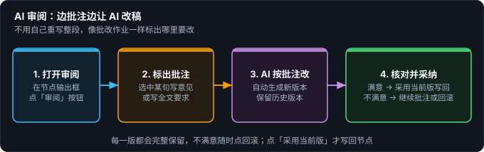

# AI 审阅与文本编辑

AI 生成的长文章、脚本或方案，往往需要来回改几遍才顺手。与其整段删掉重写，不如用内置的 **AI 审阅** 像批改作业一样标出修改意见，让 AI 精准修订。

## 用 AI 审阅边批注边改稿

1. **打开审阅窗口**：文字节点生成结果后，在输出框顶部点 **审阅**。
2. **添加批注**：
   - **局部批注**：用鼠标选中你想改的那句话或那一段，写下意见（例如「这里语气太生硬，改得轻松一点」或「补充一个具体例子」）。
   - **全文批注**：如果要调整整体风格、字数或结构，直接写一条全文意见。
3. **让 AI 修订**：点「让 AI 依据批注修订」，AI 会对照你的每一条批注产出新版本。
4. **核对与采纳**：
   - 每一版修改都会完整留存，随时可以切回历史版本对照看。
   - 不满意就继续加批注，或者点**回滚**把某一历史版本重新设为当前版继续编辑。
   - 满意后点 **采用当前版**，改动才会写回画布节点。

> **会话里也能加批注和贴图**：在「智能会话」的回复上同样可以框选文字加批注；批注卡片里还支持点「插图」贴截图或选本地图片，把图连同意见一起发给 AI 改。

## 内置 Markdown 编辑器的顺手用法

画布文本节点、审阅窗口、项目文件预览和研究笔记，用的都是同一套 Markdown 编辑器，手感一致：

- **两种视图随时切**：
  - **阅读 / 所见即所得**：像看成品文章一样直接编辑，标题、列表、表格和数学公式都会直接排好版。
  - **源码模式**：左源码、右预览，改复杂表格、代码块或精确调换行时切到源码最踏实。
- **缩进与反缩进**：在编辑器里按 `Tab` 插入缩进，按 `Shift + Tab` 减少缩进，选中多行可以整块一起缩进。
- **直接粘贴文字或图片**：从网页、Word 或微信复制过来的内容，直接 `Ctrl + V` 就能粘贴进来；截图也可以直接粘贴进支持插图的编辑区。
- **不乱改你的原稿**：只要你没动手修改内容，打开看一眼再关掉，编辑器绝不会擅自重排或改写你的原文。
