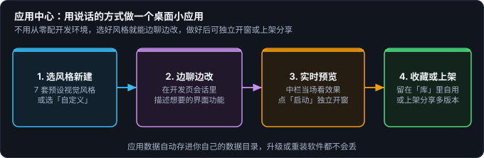

# 打造自己的桌面应用

想做一个顺手的小工具——比如个人记账本、提示词卡片箱、倒计时看板、或是专门配合某条画布使用的可视化小软件？在 MTNode 的 **应用中心** 里，你不需要懂前端打包、也不用配开发环境，像聊天一样说出想法，就能做出能独立开窗运行的桌面小应用。

## 应用中心的三个页面

点顶栏的 **应用** 打开应用中心，左侧有三个入口：

- **应用**：逛云端应用市场，看别人分享的应用，一键下载安装，或者切换同一应用的不同作者分支与版本。
- **库**：管理你本机已经下载好、或自己做好的应用，点一下就能以独立窗口启动，也可以弹出到画布外常驻使用。
- **开发**：你自己动手做应用的工作台——左边选应用和开发会话，中间实时预览页面，右边和 AI 边聊边改。

## 四步做出你的第一个应用

1. **点左上角「新建应用」**：起个名字，挑一套喜欢的视觉风格——内置 **7 套预设风格**（极简、科技、暖读、编辑、终端、玻璃、复古印刷，涵盖深色与浅色），每一套都有真实首屏预览图；也可以选「自定义」，让 AI 先问清你想要的感觉再设计。
2. **在会话栏里说需求**：不用写代码，直接告诉 AI「帮我做一个每日待办看板，左边分组，右边清单，能按优先级筛选并自动保存」。
3. **中栏实时看效果**：AI 改完后中栏立刻刷新预览。预览栏顶部一排按钮可以一键：**打开应用文件夹 📂 · 启动独立窗口 · 上架 · 刷新 · 应用设置 · 画布**。
4. **随时换风格或微调**：想换套皮肤、加个新按钮、改一下配色，直接接着聊就行；在应用内输入框里还默认自带 `Tab` 输入补全和底栏语音听写，体验和主程序一样顺手。

## 应用能用哪些本机能力（安全又省心）

在预览栏点 **应用设置 → 应用能力**，可以按需勾选这个应用能调用的宿主能力（勾上就是永久允许，取消勾选立刻收回，不会每次运行反复弹窗打扰）：

- **本地数据存取**：你的应用数据会自动存在 MTNode 专用的本机数据目录里，**绝不会写进应用代码目录**，软件升级或重装应用都不会丢数据。
- **读写画布与调用 AI**：允许后，你做的小应用可以直接读取或驱动 MTNode 里的画布流程、调用模型生成文案/图片，甚至读写你的素材库，把复杂工作流包装成一个「点两下就能用」的傻瓜界面。
- **独立窗口与画布弹出**：做好的应用既可以摆在画布上，也可以一键弹出成独立桌面窗口，在窗口里按 `F1`–`F4` 和 `Ctrl + Tab` 同样生效。
- **记住页面状态**：在「应用设置」里开启「维持状态」（默认开），开发预览刷新时尽量保住当前页面状态，调界面更省事。

## 常见小问题

- **新建完页面只有欢迎字样**：这是正常的起点页，在「开发」页的会话框里给 AI 说第一句话，它就会把欢迎页改成你要的应用。
- **想看应用文件在哪**：点预览栏最左的文件夹图标 **📂** 就能直接打开本地源码目录，也可以点「画布」进入它的开发节点图。
- **做好的应用想发给朋友用**：点预览栏的 **上架**，详情见 [上架应用与多版本管理](#app-publish)。
