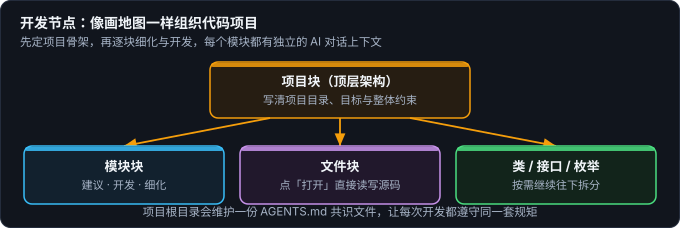

# 开发节点：用画布做项目

写一个稍微大一点的软件项目时，全靠一个聊天框来回聊，很快就会聊乱、忘了前面定好的结构。**开发节点**让你把整个项目画成一张一目了然的模块地图，每个模块绑定自己独立的 AI 开发会话，想改哪一块就直接点哪一块。

## 开发节点是什么

开发节点本质上是带「开发」标记的节点层，可以按「**项目 → 模块 → 文件 → 类 / 接口 / 枚举**」一层层展开：

- **一眼看懂每个块干什么**：卡片说明分两段——「功能」用白话说清这个模块的作用，「实现」记录关键思路和涉及的核心文件。
- **一块一会话，互不串台**：在某个模块块上点的每次开发或细化，都会在属于这块功能自己的会话里运行（所属画布 = 该功能块所在的画布），不会把别的模块上下文混进来，也能省下 AI 满项目瞎找文件的时间和 token。
- **不适合太小的活**：如果只是写个十几行的小脚本，直接开一条普通「智能会话」更快，不用专门搭开发节点。

## 卡片上的四个常用按钮

- **建议**：让 AI 先调研现状，给你列出几套可选方案，勾选你认同的方案再动手。
- **开发**：按确认好的方向真正去建目录、写代码、跑验证。开发对话框里还可以在「**先拷问需求**（先问清所有细节再干活）」和「**快速热修**（小改动直奔主题、少走冗余步骤）」两档间二选一（互斥）。
- **细化**：把当前模块继续往下拆成下一层子模块、文件或类，拆完自动摆进这个块里面。
- **打开**（文件节点专属）：直接在 MTNode 内置编辑器里打开、修改并保存这份代码或说明文件。

## 共识文件与工作区继承

- **项目共识文件（`AGENTS.md`）**：在项目根目录维护一份 `AGENTS.md`，写清目录约定、不能碰的文件清单和必须遵守的规则。项目里每个开发会话开工前都会先读它，保持风格和规矩一致。
- **核心文件回写**：每块开发收尾后，卡片会自动记录这块产出的核心文件清单（最多 10 条），以后回头看架构一目了然。
- **项目目录与左侧文件树**：在最外层项目块填一次项目根目录，里面的子块会自动继承；画布左侧切到「文件」页签就能直接浏览和编辑项目里的真实文件。
- **Agent 模型 / 预设 / 思考强度**：点块上的模型设置可以单独指定「模型提供商 / 模型 / 预设档 / 思考强度」三格配置，子块各自就近继承外层设定；三格都留空时，默认档 = 极简模式，且预设不再改写思考强度（思考深度只看「思考强度」这一格）。还可以按功能色板自定义节点外框颜色，让整张架构图更清晰。

## 从哪开始最快

- **从零做新项目**：打开画布右侧助手，说出你的目标（比如「帮我用 Python 做一个本地图片整理工具，先搭开发节点架构」），AI 会先和你确认关键点，再搭出顶层项目块、模块骨架和 `AGENTS.md`。
- **接手已有老项目**：在画布空白处右键 → **构建工作流** → 选用「开发节点架构师」并填入老项目路径，AI 会扫描真实目录，帮你把现有代码梳理成清晰的模块地图。
