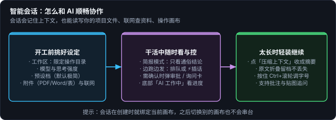

# 智能会话与权限

如果你需要的不是「一问一答」，而是让 AI 真正动手帮你干活——读你电脑里的资料、整理文档、写代码、上网查信息、或者直接修改当前画布——那就切换到顶栏的 **会话** 视图。

## 会话怎么用最顺手

1. **先选工作区**：点输入框上方的「选择工作区」，挑一个项目文件夹（默认跟着当前画布的工作目录走）。AI 的读写操作都会围绕这个文件夹进行。
2. **挑好模型、预设与思考强度**：点「⚙」按钮按任务选档：
   - **预设档**决定 AI 的工作风格（不动思考强度，思考深度只由「思考强度」单独控制）：

| 预设档 | 适合什么活 |
| --- | --- |
| **极简模式（默认）** | 最省事、少废话，直接给结果 |
| **标准模式** | 画布编排、文件整理与日常内容任务兼顾 |
| **思维精简** | 需要认真推理，但希望输出简洁、不车轱辘话 |
| **PTC 模式** | 多步串行任务，一步步推进方便核对 |
| **创造模式** | 开放写作与头脑风暴，允许更充分的发挥 |

   - **思考强度**：无 / 低 / 中 / 标准 / 高 / 最强。普通日常任务选低或中，复杂推理或写架构再开高。
3. **发文档、开联网、直接聊**：
   - 点输入框右下角 **＋**（或直接把 PDF、Word、文本、表格拖进输入框），模型会直接阅读附件并引用原文。
   - 在 **设置 → 智能能力** 开启「联网搜索」（默认开，支持 DeepSeek 官方与 MTNode 中转）后，AI 查网页时会在回答下方附带可点击的来源卡片和行内引用标记。

## 边跑边看、边跑边控

- **简报模式（原始 / 简报切换）**：AI 跑复杂任务时工具调用很多，觉得刷屏看不清？打开「简报模式」，MTNode 会同步把执行过程提炼成通俗易懂的进度摘要，随时可以切回原文看细节。
- **运行中突然想补充一句**：AI 正在干活时你再按发送，会弹出一个小卡片问你是「**加入发送队列**（等这轮跑完再发）」还是「**⚡ 插话**（下一步立刻听见）」。想跳过选择直接插话，在消息开头加 `/btw `，或者按 `Alt + Enter` 就行；也可以点 **⏸ 暂停** 先让它停下来等你。
- **先拷问需求（默认开启）**：在「模式」菜单里开启时，遇到新建或改东西的复杂需求，AI 会先用选择题卡片把关键细节问清楚再动手，避免做偏返工。普通问答和查资料不会追问。
- **查看执行轨迹**：点会话顶部的「轨迹」标签，可以用时间轴一目了然地回看每一步花了多久、用了多少 token，支持拖动和滚轮缩放时间轴；双击任意一条立刻跳回对话对应位置。
- **调整字号与批注插图**：在会话正文区按住 `Ctrl + 滚轮` 可以放大缩小字号（共 10 档，自动记住）。选中 AI 回复里的文字还能直接写批注，并点「插图」把截图附在批注里发给它改。

## 会话太长怎么办：压缩上下文

聊久了对话很长，既费 token 又容易变慢。点输入框上方的 **压缩上下文**（或发送 `/compact`），确认后 AI 会把较早的对话和工具结果收成一段精简摘要：

- **聊天记录不会丢**：被压缩的旧消息会在原位折叠成一行「已压缩的历史 · N 条」，点开照样能看原文，只是不再占模型记忆。压缩后旁边会出现「**查看压缩摘要**」，随时查看内容（手动压缩不做撤销）。
- **自动压缩**：在模型菜单里可以设置自动压缩线（150K / 300K / 450K 或自定义），到了阈值会自动帮你压一次，也能自己定保留多少最近原文。

## 审批、权限与安全边界

因为智能会话能读写文件、执行命令、上网，所以 MTNode 把权限交给你自己把控：

- **审批与权限面板**：点顶栏右上角的 **审批**（盾牌图标），可以选权限预设，或按工具逐项决定「自动允许 / 每次弹窗询问 / 禁止」。
- **遇到高风险操作会先问你**：执行命令或修改敏感内容时，弹窗会写清它要干什么，你点「允许」它才动手，点「拒绝」它会停下换方案。
- **子代理（委派）**：复杂任务中 AI 可以派出子代理去单独查资料或跑子任务，跑完只把结论带回来，省得把主对话塞满。在 **设置 → 智能能力 → 子代理** 里可以控制开关与最多嵌套层数（默认 1 层，防止失控消耗 token）。
- **自带本地听写与看视频工具**：在会话里直接让 AI 听音频做字幕或分析视频画面即可，它会自动调用本地免费离线语音识别和抽帧识图，不需要额外折腾安装。
