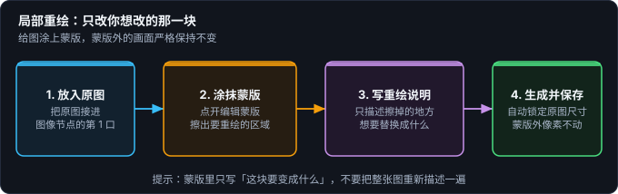

# 图像编辑与蒙版重绘

AI 画完一张图，常常整体都很满意，只有某个角落不对劲——比如多了一根手指、背景里有个路人、或者想给人物换一件衣服。这时候不用整张重画，用**蒙版局部重绘**只改那一小块就行。

## 操作步骤

1. **放好原图**：把需要修改的图片放进「图像输入」节点，连到「图像生成」节点的第 1 个图片输入口。
2. **涂抹蒙版**：在图像节点上点开**编辑蒙版**，用画笔把你想改动的那一块涂抹掉（透明/涂抹区域就是交给 AI 重绘的地方）。
3. **写清重绘要求**：在提示词里**只写这一块要变成什么**，比如「把这里换成一只趴着的橘猫」或「去掉路人，补上自然延续的草地和石板路」。
4. **运行并保存**：点 **▶** 生成。结果满意后连到「保存」节点落盘。

## 几个能让效果好很多的技巧

- **不要重新描述整张图**：只描述要改的局部以及它和周围的衔接关系，画面会更自然。
- **涂得稍微大一点点**：蒙版边缘比目标物体略微多留出一圈过渡空间，AI 融合光影和边缘时会更顺滑。
- **原图其他部分绝对放心**：带蒙版生成时，MTNode 会自动锁定原图分辨率；就算模型偶尔「手痒」动了蒙版之外的地方，MTNode 也会把蒙版外的原始像素原样保护回来，绝不会越界改坏。
- **蒙版需要亲手涂**：目前 AI 助手无法替你画蒙版，动手涂几笔只需要几秒钟，效果也最精准。
