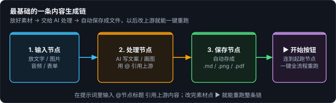

# 文字与图像生成

画布上最常用的组合就是「输入 → 处理 → 保存」：把你的素材放进输入节点，交给文字或图像节点让 AI 加工，再连到保存节点自动存成文件。

## 文字生成（文字处理节点）

把上游传来的文字、文档或图片交给大模型，输出你想要的新文字。

### 两种模式怎么选

- **普通模式（默认）**：发一次请求、拿一次结果，速度快、花费低，适合改写、翻译、总结、提取信息。结果直接连「保存」节点存成 `.md` 或 `.pdf`。
- **智能模式**：开启后这个节点就变成了一个能自己动手的小助手，会自己读项目里的文件、分多步完成任务并直接写文件，所以通常不用在后面再接「保存」节点。

### 常用设置

- **提示词**：写清「你要什么、给谁看、什么格式、大概多长」，并用 `@节点标题` 引用上游节点的内容。
- **模型与思考强度**：在节点顶部点 **⚙ 设置** 切换服务商和模型。日常任务用 `flash` 级模型又快又便宜，写长文或复杂推理再换更强的模型；**思考强度**越高想得越深，但耗时和费用也会增加，平时选「低」或「高」就够用。

### 实用场景举例

- **改口播稿**：文本输入（原文） → 文字处理（「把 @原文 改成 2 分钟短视频口播稿，口语化、保留所有核心事实」） → 保存（`.md`）。
- **看图写文案**：图像输入（产品图） → 文字处理（「根据这张图写 3 条小红书种草文案，带标题和标签」） → 保存。
- **批量处理多条内容**：用「文件输入」或「合并」传入多条素材，开启节点的**批量模式**，它会逐条处理并各自输出结果；如果想让 AI 一次看到全部素材做汇总，切到**聚合模式**即可。

## 图像生成（图像生成节点）

用文字描述想要的画面，或者连入参考图让 AI 出图。

- **文生图**：直接在提示词里写画面主体、构图、光线、风格，点 **▶** 生成。
- **图生图 / 多图参考**：把 1 张或多张图片节点连进图像生成节点，在提示词里说明「参考这张图的画风 / 保留人物长相，把背景换成海边日落」。
- **抽卡次数**：一次可以连续生成 1–10 张，挑最满意的那张留下来。
- **透明背景**：需要做贴纸、图标、商品抠图素材时，在节点设置里打开透明背景即可直接得到带透明通道的图片。
- **本地免费出图**：如果不想按张花云端生图费，可以在顶栏 **插件** 里安装 **FLUX 3 Image Klein** 或 **Qwen Image 2.1**，在自己显卡上免费生图，操作方式和云端图像节点基本一致。

## 保存结果

- **保存节点**：连在文字、图像或视频节点后面，填好保存路径和文件名即可自动落盘（文字存 `.md`，图片存 `.png` 等）。
- **生成 PDF 节点**：想把 AI 写的报告、方案直接排成漂亮的 PDF 时用它，标题、列表、表格、数学公式都会自动排版好。
- **节点自带输出路径**：音乐、语音、视频生成节点通常自带「输出路径」设置，跑完直接写进磁盘，不用再多接一个保存节点。

> **小提醒**：一般随口问个问题不用专门建画布节点，直接按 `F2` 打开 DeepSeek 对话抽屉更省事；需要**反复修改、批量处理、多步串联**的事情，放在画布上才最值。
