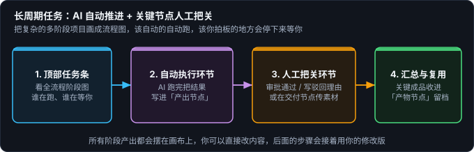

# 长周期任务（多步骤与把关）

有些活不是点一下就能一口气跑完的——比如「调研资料 → 写初稿 → 你审核提出修改意见 → 补交素材 → 配图合成 → 终稿验收」。**长周期任务**就是把这种多阶段流程画成一条清晰的阶段图，AI 自动推进能自动的步骤，到了需要你审核或交材料的地方就自动停下来等你。

## 在哪看到和控制长任务

启用长周期任务后，画布上方会出现一条**任务状态条**（点开可以看到完整的流程图）：

- **谁在跑、谁在等你一眼看清**：每个环节用不同颜色标出待运行、运行中、等待人工、已完成或失败。
- **卡片大小可调节**：流程图卡片里的文字按**卡片宽度截断**，不会乱探出框外；拖卡片**右下角**的小手柄就能缩放大小，拉宽后文字按新的宽度重新排、多显示几行，**卡片大小随画布一起存盘**。
- **绑定与停用**：在长任务设置里点「启用并绑定」就能把流程绑到当前画布，不用时点「停用解绑」随时收起。

## 三种专门摆在画布上的落点节点

长任务运行过程中，MTNode 会自动在画布上帮你建好三类专属节点（装在一个整洁的节点层壳里，不用你手动添加）：

- **产出节点**：AI 在某个阶段跑出来的文字报告、方案和文件引用会直接写在这里。点节点上的 **✎** 可以直接修改内容，后面的环节会自动采用你改过的新版本。
- **交付节点**：流程需要你提交指定文件（比如客户 LOGO、参考音频、修改后的表格）时会出现。每个待交文件对应一个输入口，连线或点「⬆ 上传」交齐后，到顶部任务条点「确认交付完成」就会继续往下跑。
- **产物节点**：把整条流程产出的关键成品（图片缩略图、文档摘要等）集中摆在一起，点 **⇢** 直接用系统程序打开、点 **📁** 打开所在文件夹。

## 人工审批与驳回

走到「人工审批」环节时，任务会暂停并在右侧亮出审批卡片：

- 看完画布上的产出节点后，觉得没问题就点 **通过**，流程继续往前走；
- 觉得要返工，在理由框里写明怎么改，点 **驳回**，流程会自动退回上一步按你的意见重做。
- **草稿不丢失**：理由框里**写到一半的内容会一直留着**，哪怕后台其他环节在刷新也不会被清空，只有你点提交（通过/驳回）或切换画布后才清空。

## 用一句话调整任务流程

跑着跑着发现流程少了一个审核步骤、或者想改一下流转条件？不用手动拆图，直接打开长任务的「修改流程」入口，用白话告诉助手想怎么改（比如「在初稿和配图之间加一个人工审核环节」），它会原地更新流程图并保留你已经跑好的产出。

## 历史运行、重试与异常处理

- **失败自动重试与跳过**：某个环节网络抖动或临时报错时，可以按设定的次数自动重试；实在过不去也可以在面板里单步重跑、跳过或指定下一跳，不用从第一步重头来。
- **历史记录随时回看**：每次完整运行都会留档，方便对比不同轮次的产出和耗时。
