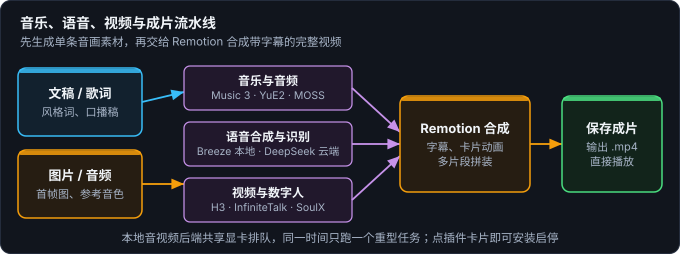

# 音乐、语音、视频与本地插件

除了写字和画图，MTNode 还能在画布上把歌词唱成歌、给文案配音、把图片变成视频或数字人，再用 Remotion 合成带字幕的完整短片。这些能力大部分通过顶栏 **插件** 按需安装，跑在你自己的显卡上，不按次花云端钱。

## 音乐与音频

- **MiniMax Music 3**：输入风格描述（如「轻快钢琴、温暖治愈」）和分段歌词（`[Verse]` / `[Chorus]`），生成完整歌曲；歌词留空则生成纯音乐 BGM。支持 1–10 次抽卡挑最好的一条。
- **YuE2 本地音乐**：擅长把完整歌词直接唱成人声 + 伴奏的整曲，也支持先出乐谱再细调或零样本翻唱。
- **MOSS-Music 音乐理解**：把一首歌或视频丢进去，让它「听懂」这首歌——自动拆出带时间戳的逐句歌词、曲风情绪、段落结构与和弦，也可以自由提问。
- **MT 音频频谱分析**：轻量免显卡工具，给一段音频或视频自动算出节拍点、速度（BPM）、小节与频谱热力图，方便给后续剪辑和 Remotion 视频做卡点。

## 语音合成与识别

你有「本机离线免费」和「云端免安装」两条路可选：

- **Breeze TTS 2（本地插件）**：装在自己电脑上，给一段参考音频就能克隆音色，也能用自然语言描述语气（比如「语速稍快、语气笃定」）。如果生成的语音有轻微电音，换采样率高一点的参考音频（推荐 32k 以上）会好很多。
- **DeepSeek 语音合成 / 语音识别（免装插件）**：直接用「设置 → 模型服务」里的 DeepSeek 官方接口，不占本地显存、打开即用。文字转语音、音视频转文字各有一颗节点，按官方接口计费。

## 视频、数字人与本地生图

- **MiniMax H3 视频生成**：支持两种常用模式——给首帧（和可选末帧）做自然过渡动画，或给多张参考图保持角色长相一致。也支持导入你**自建 ComfyUI 工作流**（在节点 ⚙ 设置里切工作流来源即可）。
- **视频超分与视频补帧**：两个独立后处理节点，可以单独用，也可以接在视频节点后面把 480p 放大到高清、把帧率提升到 2 倍或 4 倍。
- **InfiniteTalk / SoulX 数字人**：给一张人物照片（或源视频）+ 一段语音，生成口型同步的说话视频。InfiniteTalk 适合长音频分段续写，SoulX 主打快速流畅出片。
- **FLUX 3 Image Klein / Qwen Image 2.1（本地生图）**：把高质量生图搬到你自己的显卡上，支持多参考图编辑、蒙版重绘、透明背景和抽卡。

## Remotion 动效成片

前面生成的文案、配音、图片、短视频片段，最后都可以交给 **Remotion 视频** 节点合成完整 `.mp4`——加字幕、做图文卡片、数据动画、片头片尾，比逐帧 AI 生成更稳更精准。Remotion 节点本身不带输出路径，记得在后面接一个「保存」节点（文件名以 `.mp4` 结尾）。

> **显存排队提醒**：本地音乐、语音、视频、数字人等重型任务会自动排队，同一时间只跑一个，防止显卡爆显存。如果遇到显存不够，先调低分辨率或缩短时长，也可以点顶栏「简略」暂时收起画布图片预览。

## 插件卡片怎么用（安装、启停、清缓存）

点顶栏 **插件**，所有本地插件卡片的操作方式完全统一：

1. **安装 / 重装**：首次使用点卡片上的「安装」（支持国内镜像），在独立安装窗里挑好安装目录就会自动一步步装好；安装过程中关掉安装窗不会中断，它会在后台继续跑。如果你已经提前下好了大模型权重，可以在安装窗里点「指定权重位置…」直接迁过去，不用重下。
2. **启用 / 停用**：装好后点「启用」即可在后台静默启动服务，不会弹出一堆黑框终端窗口；不用时点「停用」释放显存。Remotion 是按需渲染的，没有常驻服务，所以不需要点启用。
3. **控制台**：想单独试生成、管理音色库、导入 ComfyUI 工作流时，点卡片上的「控制台」。关掉控制台窗口不会停掉后台服务。
4. **查看日志与一键清理缓存**：点卡片封面右上角的 **ⓘ** 按钮，就能随时看运行状态、显存占用和最新日志；同一面板里的「**产出物缓存**」还能一键清理插件攒下的临时产出（可选「保留近 7 天」或「全部清理」），不会碰模型权重和运行环境，轻松腾出硬盘空间。
5. **卸载**：在「安装 / 重装」窗口底部点「卸载」，会先列出删什么、留什么，确认后才动手，你导出的成品文件会安全保留。

## 插件报错弹窗与自动修复

本地环境偶尔会遇到依赖冲突或启动失败。当插件报错时，主窗口会弹出一份清晰的错误报告，告诉你哪个插件出了什么错，并提供三个选项：**自动修复**、**打开控制台看日志**、**忽略**。

点 **自动修复** 后，MTNode 会在左侧新建一条透明可见的修复会话，工作区限定在该插件的安装目录（不会乱删你的模型或成品），由 AI 帮你排查并修好问题，修完自动重启该插件服务并提示「服务已重启」（Remotion 则直接重跑报错节点）。同一条错误只会自动修复一次，避免反复打扰；如果是显卡不支持、驱动太旧或磁盘空间不足这类硬件问题，报告里会直接告诉你怎么处理。
