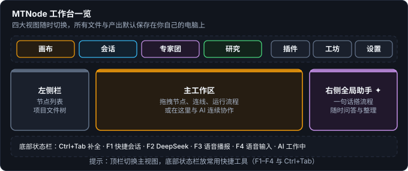

# 认识 MTNode

MTNode AI工作站是一款装在你电脑本地的 AI 创作与工作流工具。你可以把它想象成一张「把想法变成流程」的桌面工作台：不用写代码，也不用把私密文件传到陌生平台，拖几个节点、连上线、点运行，就能反复产出文章、图片、配音、视频、研究笔记，甚至做出自己的桌面小应用。

## 四个主视图，各管各的事

顶栏左上角有四个视图按钮，随时切换：

- **画布**：最核心的工作区。把「输入素材 → AI 处理 → 保存结果」摆成一张流程图，改一下开头素材，整条链就能一键重跑。
- **会话**：全屏的 AI 协作对话。这里的 AI 不只会聊天，还能帮你读文件、写文档、上网查资料、操作浏览器、修改画布。
- **专家团**：给当前画布配一组不同角色的 AI 专家（比如产品经理、设计师、审稿人），可以一对一聊，也可以开圆桌会一起讨论出建议。
- **研究**：适合写论文、做调研、啃资料。把文档和 PDF 丢进去，自动整理出笔记、术语、三遍读法、知识图谱和演示讲义。

除了这四个视图，画布右侧还有随时能呼出的 **全局助手（✦）**，说一句话就能帮你搭好整条工作流。

## 三分钟跑通第一条流程

第一次打开 MTNode，按下面三步就能跑出第一个结果：

1. **接上 AI 模型**：点顶栏 **设置 → 模型服务**，填入一个 API Key（新手推荐 DeepSeek），或者登录后使用账号自带的 MTNode 中转服务。详见 [配置模型与 API Key](#providers)。
2. **让助手搭一条链**：回到「画布」，点右上角 **✦** 打开全局助手，直接说一句你的需求，比如「帮我搭一条流程：输入一段产品介绍，改写成 300 字短视频口播稿并保存」。
3. **改素材并运行**：把输入节点里的示例文字换成你的内容，点开头的 **▶** 按钮，稍等片刻就能看到结果落盘。

## 你的数据放在哪里

MTNode 是本地优先的桌面软件，**所有画布、对话记录、素材和配置都只存在你自己的电脑上**，默认放在系统应用数据目录里，也可以在「设置 → 配置数据目录」里改到你习惯的磁盘。

> 软件升级或卸载会替换程序安装目录，所以 MTNode 不会把任何用户文件保存在程序文件夹里。如果顶栏出现红色警示，点开按提示把数据目录挪出去即可。

## 外观与更新

- **换一套顺眼的主题**：在「设置 → 外观」里可以切换四套主题（含最新的**亮色**主题），白天晚上都能看得舒服。
- **切换中英文**：点右上角地球图标可在中文和英文之间即时切换，手册与 AI 回复语言也会跟着切。
- **无打扰更新**：有新版本时顶栏会出现「更新」提示。下载和准备都在后台悄悄完成，不打断你干活；准备好后由你自己点「重启并更新」再换上新版。

## 接下来看什么

- 还没配模型 → [配置模型与 API Key](#providers)
- 想认识底栏的语音、补全、小窗快捷键 → [底栏工具、语音与快捷键](#quick-tools)
- 想自己动手摆节点、连线 → [画布基础：节点、连线与排版](#nodes-wires)
