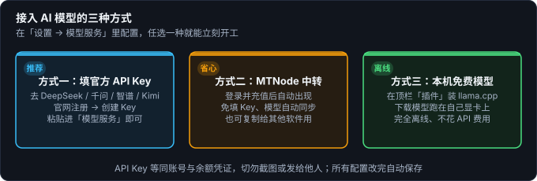

# 配置模型与 API Key

MTNode 本身只是一个工作台，真正帮你写文案、画图、做分析的「大脑」来自你接入的 AI 模型。在顶栏点 **设置 → 模型服务**，用下面任意一种方式接上模型就能开始使用。

## 方式一：自己填官方 API Key（推荐）

### API Key 是什么

你可以把 API Key 理解成「AI 平台的充值会员卡」。去模型厂商官网注册账号、领免费额度或充一点钱（比如先充 10 元试水），在后台生成一串 `sk-` 开头的字符，粘进 MTNode 就能调用它的模型。用一次扣一次费，不用不扣钱。

> **安全提醒**：这串字符等同于你的账号和密码。不要发到群里、不要截图给别人、也不要写进公开文档。如果不小心泄露，立刻去官网后台删掉旧 Key 再新建一个，重新创建是免费的。

### 国内常用服务商（选一家就够用）

- **DeepSeek（新手首选）**：性价比高、速度快、中文和代码能力都很强，日常用这一家基本就够了。注册地址：https://platform.deepseek.com/
- **通义千问 Qwen（阿里云百炼）**：https://bailian.console.aliyun.com/
- **智谱 GLM（BigModel）**：https://bigmodel.cn/
- **Kimi（月之暗面）**：https://platform.moonshot.cn/

### 三步填进 MTNode

1. 在官网登录并进入「API Keys / 密钥管理」页面，新建一个 Key 并马上复制保存（大多数网站只完整显示这一次）。
2. 打开 MTNode 的 **设置 → 模型服务**，点开对应的服务商卡片（或点「新增服务商」）。
3. 把 Key 粘贴进输入框，点「完成」即可。**所有设置都是即时自动保存的**，不需要再找保存按钮。

## 方式二：用 MTNode 中转服务（免自己注册）

如果你不想折腾注册和买 Key，登录 MTNode 账号并充值后，**设置 → 模型服务** 里会自动多出一张「MTNode 中转服务」卡片。模型列表和密钥都会自动同步好，直接就能用。

- 卡片上会展示完整 Key 和接口地址，点旁边的「复制」也可以拿去别的 AI 工具（如 Codex）或桌宠里共用。
- 如果担心 Key 泄露，点「更换 Key」会立刻生成新的一串、旧的马上作废（每天最多换 5 次）。平时没必要频繁换，只要余额够就能一直用。

## 方式三：在本机跑免费模型（llama.cpp）

如果你有一张还不错的独立显卡，想完全离线、零 API 费用地跑开源模型，可以在顶栏 **插件** 里安装 **llama.cpp 本地模型**。

装好后，「设置 → 模型服务」里会自动出现一张 **llama.cpp 本地** 卡片，所有已下载的本地模型都会自动列在上面，不用手动填写：

- 每个模型旁边会标出当前状态（运行中 / 加载中 / 未部署 / 加载失败），点「部署」即可加载到显存，不用时点「停止」释放显存。
- 你也可以直接在节点或会话里选中一个「未部署」的本地模型，点运行时 MTNode 会自动帮你先拉起后端并加载模型（首次加载可能需要几十秒到几分钟），不需要提前手动启动。
- 下载或删除模型文件，点插件卡片上的「控制台」即可操作。

## 想用国外模型或图片生成模型

如果需要调用海外大模型或 GPT 图片生成，可以自行选择靠谱的第三方聚合平台。在 **设置 → 模型服务** 里点「新增服务商」，按该平台的说明填入接口地址（Base URL）和 API Key 即可。

- 聚合平台属于第三方转发，请先确认对方口碑并小额试用；国外旗舰模型通常较贵，注意在平台后台设置消费上限。
- 如果添加的是**图片生成模型**，新增服务商时记得把类型选成「图像 OpenAI 兼容」。

## 实用进阶项（平时留空就行）

点开任意服务商卡片，下面还有几项按需使用的开关，不填就保持默认：

- **模型白名单 / 黑名单**：某家服务商底下挂了几十上百个模型、下拉框太长不好找时，可以用白名单只留想要的（比如填 `deepseek-*`），用黑名单屏蔽不用的（比如 `gpt-image-*`）。支持 `*` 和 `?` 通配符，多个用逗号或空格隔开。被过滤的模型会标上「策略外」，只是从下拉菜单里藏起来，不会删你的配置。
- **停用该服务商**：暂时不想用某家时勾上它，所有模型选择器里都会把它隐藏，但你的 API Key 和配置原样保留，随时能勾回来。画布上已经绑了它的旧节点也不受影响。
- **看图（识图）不用单独开关**：MTNode 默认认为你选的模型能看图，直接发就行（DeepSeek 默认模型就支持识图）。如果某只模型真的不支持图片输入，运行时会明确告诉你原因，换个支持看图的模型重跑即可。
- **请求超时（毫秒）**：默认 300000（5 分钟），分连接超时、首字节超时、分块超时三档。平时留空用默认即可；网络较慢或遇到长思考模型容易断连时再调大。
