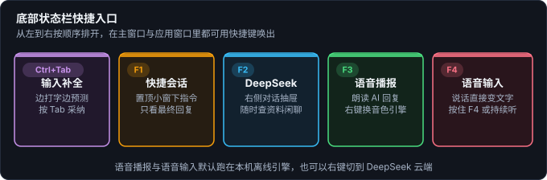

# 底栏工具、语音与快捷键

MTNode 窗口最下方有一排非常顺手的快捷工具，不管你正在画布排节点、在会话里聊天，还是在独立应用窗口里写东西，按一下快捷键就能立刻呼出。

## 底部状态栏从左到右有哪些工具

### 1. 输入补全（`Ctrl + Tab`）

状态栏最左边的图标，打开后在任何输入框里停顿一下，光标后面就会出现 AI 预测的下一句话，按 `Tab` 直接采纳。详情见 [输入补全（边打字边预测）](#fim)。

### 2. 快捷会话小窗（`F1`）

适合「想到一件事，马上吩咐 AI 去做」的场景。按 `F1` 会在鼠标附近弹出一个置顶小窗：

- **只看结果不刷屏**：小窗里只显示你刚发的那句话和 AI 的最终答复，不展示中间的思考和工具过程，跑完自动更新。
- **随时切会话或回主窗**：点左上角 **☰** 可以切历史会话，点 **＋** 新建一条，点 **↗** 可以把这条会话直接带回主窗口查看全过程。
- **关窗不丢草稿**：没发出去的字会自动留着，下次按 `F1` 还在。

### 3. DeepSeek 对话抽屉（`F2`）

按 `F2` 从窗口右侧滑出 DeepSeek 官方网页对话。平时查个资料、随口问个问题不用切出软件，也不消耗你的 API 余额；再按 `F2` 或 `Esc` 收起，登录态和聊天记录都会保留。

### 4. 语音播报（`F3`）

想解放眼睛、听 AI 读出回复时，按 `F3` 或点小喇叭打开语音播报。

- **默认完全免费离线**：首次开启会自动下载本地语音模型（约 500MB），在本地电脑直接合成朗读。
- **右键切换引擎与音色**：右键小喇叭可以上传参考音频克隆音色、引用 Breeze 音色，或者切到 **DeepSeek 云端** 引擎（按官方接口计费，边下边播、音质更自然）。
- **状态栏字幕条**：播报中的文字（或最新一轮 AI 答复）会单行显示在状态栏中间，点一下可以向上展开看全文。

### 5. 全局语音输入（`F4`）

不想打字时，直接说话就能把文字写进**当前光标所在的任意输入框**（会话框、节点提示词、研究笔记、搜索框都行）。

点话筒按钮会在三种状态之间切换：

| 状态 | 按钮样子 | 怎么用 |
| --- | --- | --- |
| 关闭（默认） | 灰色 🎤 | 不占用麦克风 |
| 持续转录 | 青色 ● | 一直听，每说完一句稍微停顿一下，整句文字自动落进输入框 |
| 按键转录 | 琥珀色 F4 | 只有**按住 `F4` 说话**时才收音，松开立刻写入 |

- **本地离线或云端任选**：默认跑在本机 CPU 上（首次需下载约 239MB 语音模型，音频不上传）。右键话筒也可以切到 **DeepSeek 云端** 识别，长段讲话更稳。
- **AI 润色（话筒旁的 ✨ 按钮）**：开启后，每说完一句会先落原始文字，再由默认文本模型悄悄帮你修正同音字、加标点、删掉「嗯/啊」等口头禅，不会改你的原意；如果你已经动手改了那句话，它也不会覆盖你写的内容。
- **焦点不在框里也不丢字**：说话时还没点进输入框没关系，识别出来的句子会先暂存着，等你点进任意文本框就会补写到光标处。
- **右键快捷菜单**：可调识别语言（默认自动识别中英粤日韩）、调整「断句停顿」时长、切换引擎或打开详细设置。

### 6. 画布高清总览图（相机图标）

点状态栏的相机按钮，可以把当前画布上的所有节点、连线和标注导出成一张清晰的大图（`.png`），方便发给同事看或存档。

### 7. 「AI 工作中」进度台

只要有 AI 任务正在后台运行，状态栏就会出现动态进度入口。点开能看到当前或最近一次任务执行到了哪一步、有没有卡在等你确认，还可以一键跳过去或直接中止。

## 常用快捷键速查

| 快捷键 | 作用 |
| --- | --- |
| `Ctrl + Tab` | 开 / 关输入补全 |
| `F1` | 打开 / 聚焦快捷会话小窗 |
| `F2` | 打开 / 收起 DeepSeek 对话抽屉 |
| `F3` | 开 / 关语音播报 |
| `F4` | 开关语音输入；按键模式下按住说话 |
| `Ctrl + F` | 全局搜索（搜画布节点、会话、文件、手册） |
| `Space` | 画布视角居中适配全部节点 |
| `D` | 隐藏 / 显示画布连线 |
| `J` / `K` / `L` | 打开插件 / 工具库 / 素材库 |
| `Ctrl + Z` / `Ctrl + Y` | 撤销 / 重做 |
| `Ctrl + D` | 原地复制选中节点 |
| `Ctrl + 滚轮`（会话内） | 放大或缩小会话正文字号（共 10 档） |
| `Esc` | 关闭当前浮层或取消操作 |
