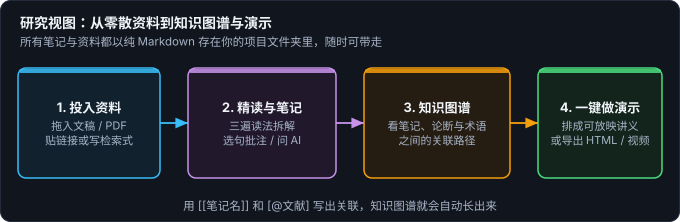

# 研究视图：笔记、图谱与演示

写论文、做行业调研、啃一堆专业文献时，资料、批注和想法常常散落在十几个文件夹里。**研究视图**（顶栏「研究」）把这一切收进一个地方：所有内容都是你项目目录里的纯 Markdown 文件，你可以随时用外部编辑器打开、备份和带走。

## 一、开始前：给课题投料

使用研究视图前，先给当前画布选好一个**工作目录**（所有研究文件都会整齐放在里面的 `research/` 文件夹下）。

第一次点开「研究」视图，点 **初始化研究**，就会进入三栏同屏的资料投料台：

1. **填课题与核心问题**：只要写了课题名就能开始，资料以后随时补。
2. **放核心文件（左栏）**：把你自己正在写的稿子（Markdown、Word、LaTeX、PPT、文本都行）拖进来，多篇时可以标一篇为「主稿」。
3. **放参考资料（右栏）**：拖入参考 PDF，或者点「＋ 文本 / 链接」贴网页、arXiv 链接、DOI、摘录；也可以点「＋ 检索式」让 AI 按关键词搜前 5 篇相关文献加入队列。每条资料都可以写一句给 AI 的重点提示（比如「重点看第 4 节实验」）。

点 **开始处理** 后，AI 会在同屏显示逐条进度：把文件复制入库（绝不动原件）、转成可读正文、生成分层阅读稿和第一批术语页。以后新加了资料，再打开资料库点 **补充处理** 就只会跑新加的那批，已经处理好的绝不重复花 token。

## 二、高效精读与写笔记

- **阅读态与编辑态分离**：打开笔记默认是清爽的阅读排版（公式和流程图直接画好）；想改文字点「编辑」切到左源码右预览，改完点「完成」。
- **三遍读法变体**：右键原文（或点「＋ 变体」），可以一键生成三份独立对照稿——**略读**（核心贡献、证据、局限）、**关键概念**（通俗解释）、**技术细节**（方法、公式与实验设置）。
- **三层折叠与节级详略**：参考资料支持一键切换「全文 / 关键原句 / 主题」，还可以针对单个章节自由切「一句话 / 一段话 / 原文」，想粗看就粗看，想细抠就展开原文。
- **框选即问即记**：读到任何一句话或公式，鼠标选中就会浮出工具条——直接**加批注**、就地**问 AI**（回答可一键存回笔记），或者把它提炼成一条**论断**。
- **术语页按需深挖**：初始化会归纳第一层关键术语；点击正文里的术语或公式，会弹出浮空卡显示定义以及「库里还有哪些笔记提到它」。想顺着某个术语继续深挖，点工具条上的 **引申** 勾选再生成，绝不未经同意无限扩散烧 token。

## 三、知识图谱与文献库

- **写下关联，图谱自动长出**：在笔记里用 `[[另一篇笔记名]]` 建双链、用 `[@引用键]` 引用文献、用 callout 块标出论断/问题/批注，点顶栏 **图谱** 就能看到一张可交互的关系网。
- **探索图谱**：支持力导向、分层、径向和时间线排布；可以按「已验证 / 存疑 / 未验证」筛选论断、聚焦某个节点的邻域，或者按住 `Ctrl` 依次点两个节点找出它们之间的最短关联路径。
- **文献库管理**：点顶栏 **文献**，支持粘贴 BibTeX、按 DOI 添加、按标题检索，或者直接导入本地 PDF 抽取全文。正文里点尚未下载全文的文献引用时，可以一键派 AI 去检索并入库（默认不会未经确认自己联网乱下）。

## 四、一键生成可放映演示与视频

课题和主稿整理好后，点顶栏 **演示** 就能自动排出一套结构完整的讲义（封面 → 大纲 → 正文 → 三遍读法 → 关键术语 → 公式 → 文献 → 结语）：

- **新建演示设置**：首次打开可选择「静态讲义 / 视频版 / 两者都要」，从 6 套明暗主题里挑一套，并可写上受众、场合和目标时长。
- **三栏演示编辑器**：左边拖页排序或增删单页，中间改文案实时预览，右边换主题、转场和页脚元素显示；还可以点星形图标让 AI 按你的口头意见重写讲稿（严格基于已有稿件，绝不编造新事实），不满意随时一键撤销。
- **多种导出**：可以直接全屏放映、导出单文件离线 HTML（双击就能播，也能打印成 PDF 讲义），或者配合 Remotion 插件一键导出成 `.mp4` 演示视频。
