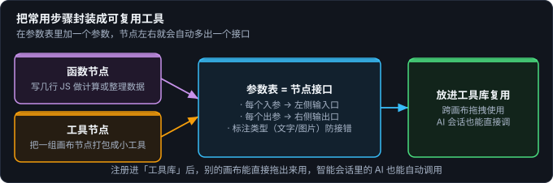

# 工具节点与函数节点

当你搭出一段特别顺手的流程（比如「把任意长文提炼成 3 条要点 + 1 个标题」），或者想对文字和数字做一点精准计算（比如算字数、拼格式、处理 JSON），就可以用到**工具节点**和**函数节点**。

## 工具节点：把一组节点打包成专属工具

如果你经常在不同画布里重复搭同一小段流程，不如把它做成一颗「工具节点」：

1. **定义参数就是定义接口**：在工具节点的参数表里加一个输入参数，节点左边就会自动多出一个输入口；加一个输出参数，右边就会自动多出一个输出口。给参数标好类型（文字、图片等），连线时就不会接错。
2. **注册进工具库**：做好后点注册，它就会出现在顶栏的 **工具库（快捷键 `K`）** 里。
3. **两处直接复用**：
   - 在任何新画布里，从工具库拖出来就像一颗普通节点一样直接连线使用；
   - 在「智能会话」和「智能节点」里，AI 也能看到并直接调用你注册好的工具。

## 函数节点：写几行代码做精准处理

大模型擅长创意和理解，但在精确计算、固定格式转换、文本切分、批量过滤这些事上，几行小代码又快又零成本。

- **怎么用**：在画布上放一颗「函数节点」，定好输入和输出参数，在代码区写一小段 JavaScript（拿到 `input`，算完 `return` 返回结果即可）。
- **不会写代码也没关系**：直接告诉右侧的全局助手「帮我写一个函数节点，把上游的文本按空行拆成数组并去掉空项」，它会直接帮你建好并填进代码。
- **安全与隔离**：函数代码会在独立的后台线程里运行，就算写错了死循环也不会把整个软件界面卡死。
