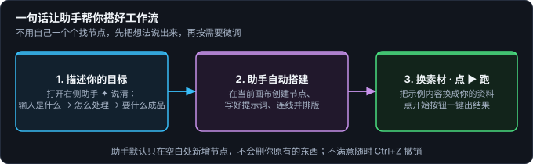

# 工作流管理与一句话搭流程

在 MTNode 里，每一张画布都是一条可以反复运行的「工作流」。你可以把不同的项目分成多张画布管理，也可以直接让右侧的全局助手用一句话帮你把整张画布搭好。

## 一句话让助手搭出工作流

不想自己一个个拖节点、连线、写提示词？交给画布右侧的 **全局助手（✦）** 就行：

1. 点画布右上角的 **✦** 打开右侧助手栏。
2. 直接说出你的目标，写清楚三件事：**输入是什么 → 中间要怎么处理 → 最终要什么成品**。
   - 例子：「帮我搭一条工作流：输入一篇产品资料，先改写成 300 字短视频口播稿，再转成语音，最后用 Remotion 合成带字幕的竖版视频并保存为 mp4。」
   - 也可以在输入框里输入 `/`（或中文顿号 `、`），点选「生成工作流」技能来套用更规范的搭图流程。
3. 助手会直接在当前画布上放好节点、连上线、排好版。你只需要把示例素材换成你自己的内容，点开头的 **▶** 就能一键跑通。

> **放心让它改**：除非你明确要求，助手默认只会在空白处新增节点，不会删改你已经搭好的部分；就算搭完不满意，按 `Ctrl + Z` 也能一步撤回。

## 多画布管理与视角记忆

- **新建、改名与切换**：顶栏可以随时新建画布、给画布改名或删除；画布上方的**标签条**让你像浏览器标签一样快速切来切去。
- **标签条切换会记住你刚才的位置**：切去别的画布再切回来，原来的缩放比例、平移位置、以及你刚才钻进的节点层都会原样保留，不用每次重新找。
- **设置工作目录**：在画布顶部给当前画布选定一个本机文件夹，保存节点、智能节点、研究视图和文件树都会默认围绕这个目录工作，项目资料整整齐齐不乱跑。

## 导入、导出与分享

- **导出备份**：点顶栏 **导出**，可以把当前画布存成一个独立文件发给同事或做版本备份。
- **导入画布**：点顶栏 **导入** 选文件，就会作为一张新画布打开。如果里面引用了你电脑上还没配置的模型，节点会自动标成「无模型」，点运行时再按提示选你自己的模型就行。
- **去创意工坊淘现成模板**：点顶栏 **工坊**，可以直接浏览并一键下载别人分享好的实用工作流模板，也可以把自己的好流程分享出去。详见 [创意工坊与讨论区](#community)。
