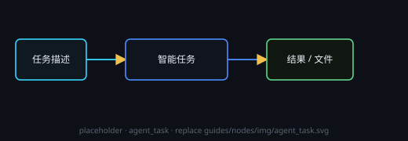

# 智能任务

通用 agent：按任务描述读文件、联网、执行命令，结果回填输出。服务商走 DeepSeek 路由。

## 端子
- **输入**：文本 / 引用
- **输出**：任务产物文本
- **组**（左排最末位那颗空心方框）：把画布组框标题栏右上角的 **□** 拖进来，这个节点就能拿到组内所有节点的清单（标题 + 类型 + 描述 + 节点 id）。一颗组端子可以接多个组，合并成一份清单；接组线不会连带运行组里的节点，要正文时 agent 会按 id 自己去画布上读。输入优先级：组输入 → 画布 → 项目文件 → 外部知识，你在任务里明说的要求永远排在最前。

## 设置
**预设 / 供应商 / 模型 / 思考强度**都在节点头部 **⚙ 设置** 打开的设置窗口里改（预设与「智能会话」同一张表）；节点卡片上只显示一行当前摘要。任务描述属于内容，仍写在节点里。

## 会话模式（💬）
点头部的 **💬** 切成会话模式：微信风格气泡（助手左、用户右），历史随节点保存，多轮追问就在节点里进行。旧的「文本对话」节点已移除，打开旧画布时会自动迁移成这种带会话模式的智能任务节点。

## 运行显示
**思考与输出分开显示**：运行时按发生顺序分段 —— **「◉ 思考 · N 字」** 只折叠模型内部推理（N 只数思考的字数），中间步骤说出来的话以正常字号**正文**逐段显示，**🔧 工具**调用就近插在发生位置，错误以 ⚠ 附在正文里。每调用一次工具或进入新一步推理就另起一段；点节点头部的 **「◉ 思考」** 按钮可放大查看（上半思考、下半输出）。

## 许可
工具能力由顶栏「审批」预设控制。
