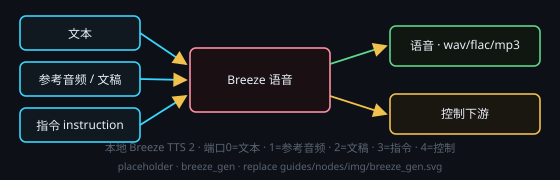

# Breeze 语音生成（Breeze TTS 2）

画布右键 → **处理节点 › 音频生成 › Breeze 语音生成**。把文本合成语音：插件「Breeze TTS 2 本地 TTS」在本机拉起的管理服务（默认 `127.0.0.1:8772`）+ 官方 `breeze_infer.api` 引擎（`127.0.0.1:8773`，按需拉起）。**每次运行只生成一个音频文件**（`.wav` / `.flac` / `.mp3`）。

## 端子
- **输入**：端口 0 = 待合成文本 · 端口 1 = 参考音频（音频文件 URL）· 端口 2 = 参考文稿（文字，或音频 / 视频输入节点）· 端口 3 = 指令 instruction · 端口 4 = 控制输入
- **输出**：端口 0 = 语音音频（下游可试听 / 保存）· 端口 1 = 控制输出

## 两个文本框（卡片上直接编辑）
- **第一个框 = 待合成的文本**（端口 0）：端口 0 有输入时这个框**只读**回显，空着才可编辑（存 `srcText`）。
- **第二个框 = 参考文稿**（端口 2）：同一条规则；接的是音频 / 视频输入节点就显示它端口 1 的转写输出，接的是音频文件则框里空着（那一路当参考音频取走），绝不把路径当参考文字。
- 框上没有标题行、也没有状态标签：**鼠标悬停**就能看到这个框归谁。本节点**不做转录** —— 参考文本自己填，或把音频节点的转写输出接到端口 2。

## 角色（音色预设）
- 一个角色 = 1 个基础音色 + N 个备选音色；每组 = 一段参考音频 + 与它逐字一致的台词 + 一句指令（+ 可选场景标签）。在节点头部 👤 按钮建：声线设计（AI 造声线）或音频参考 → 生成 3~6 条候选 → 挑一条当基础音色。
- 节点上方 👤 打开角色跳窗：左边挑角色，右边每组配**波形播放器**试听台词与指令，点「**用这一组**」即生效（关窗并写回节点）。
- 选了角色后端口 1 / 2 在卡片上隐藏、也**不参与合成**，卡片上只剩一个文本框。
- **指令**：端口 3 或设置里的指令**非空就覆写**那一组的指令；留空用组里自带的那句。

## 设置
- 在节点头部 **⚙ 设置** 打开的设置窗口里改。
- **音色（音色库）**：安装目录 `voices/<id>/{ref.wav, ref.txt}`，留空 = 用端子的参考音频 · **能力**：自动判定 / 音色克隆 / 音色设计 / 音色导演（选了角色时这两行不出现）
- **指令 instruction** / **cfg_scale**（0.1–10，默认 4；克隆模式恒 1.0）/ **种子**（默认 42）+ **摇数（每次执行种子 +1）**
- **输出格式**：wav / flac / mp3（需 ffmpeg）· **抽卡次数**（1–10）· **输出路径**：接了保存节点可留空

## 注意
- 许可：推理代码 Apache-2.0，但权重与自托管输出受 **BreezeBlue** Research and Non-Commercial License 约束，仅限研究与**非商用**用途；禁止未授权克隆与冒用。
- 给了参考音频就必须同时给参考文本，官方接口要求**成对**（框里填、或接音频节点的转写输出），否则节点本地就拦下并指路。
- mp3 需要 **ffmpeg**（安装目录 `tools/ffmpeg/`）；缺失时建议改用 wav / flac。
- 与音乐 / 视频同一条串行链并持**全局音视频互斥锁**（引擎 eager 约 7.7GB 显存）；需要 NVIDIA GPU，12GB 起步。
- **插件报错弹窗**：按技能 `breeze-tts-local-install` 在本插件 INSTALL_DIR 里自动修复并重启后端；主动取消、安装中、磁盘不够、没 N 卡这类只报告不自动修。
