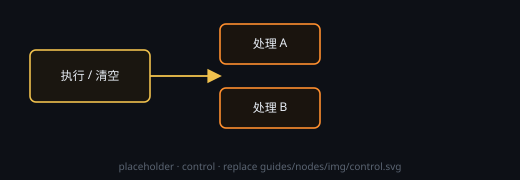

# 执行 / 清空

批控节点：把要操作的节点连到它（连出或连入都算），点 ▶ 按当前动作一次跑完或清空。

## 端子
- **输入**：控制（从这一侧连进来的节点也算目标）
- **输出**：控制（连出去的节点算目标）

## 设置
- 在节点头部 **⚙ 设置** 打开的设置窗口里改；**动作**：执行 / 清空（默认执行）
- **补缺：只执行尚无输出的节点**（默认关）
- **固定节点（不可删除）**（默认关）：勾上后这颗节点删不掉
- 管哪些节点只在画布上连线，设置窗口里只列当前清单

## 用法
- 节点头部另有 **清空 / 执行 / 补** 三颗开关，最右是 **▶** 与 **■**
- **执行**：跑已连接节点；**清空**：清掉它们的结果；**补缺**：只跑还没有输出的节点

## 注意
- 目标里有节点正在运行时，执行和清空都会被拦下（先停再点）。
- 清空不受「补缺」影响，永远全清。
