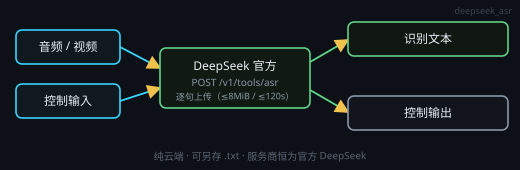

# DeepSeek 语音识别（云端 · 官方 API）

画布右键 → **处理节点 › 音频生成 › DeepSeek 语音识别**（`deepseek_asr`）。把音频（或视频里抽出的音轨）交给 **DeepSeek 官方** `POST /v1/tools/asr` 转成文字。

服务商**不可选**：节点恒取「设置 · 模型服务」里那条**官方 DeepSeek**。没配 Key 时节点在本地停下并指路，不会偷偷换服务商。

## 端子
- **输入**：端口 0 = 音频 / 视频（音频输入节点、语音合成节点、保存节点均可）· 端口 1 = 控制输入
- **输出**：端口 0 = 识别文本 · 端口 1 = 控制输出

## 运行
- 节点头部的 **▶** 直接跑这一颗（控制节点也能指挥它）。端口 0 没接音频时会先提示「没有音频输入」，而不是先去报 Key —— 接线是你这一拍就能改的事。跑完卡片上写「已转写：N 句 / M 秒」。

## 卡片
- 上方显示接进来的音频文件名，下方是识别结果预览（长文截断显示，全文在端口 0 与「复制」里）。

## 设置（节点头部 ⚙ 打开的设置窗口）
- **断句停顿**：`跟随全局`（默认，与设置 · 语音输入里那一项同源）/ 200 / 300 / 500 / 900 / 1200 ms —— 停顿超过这个长度就切一句，**每句一次请求**，结果是逐行文本
- **转写结果另存 .txt**：留空 = 只出文本（接到下游节点用）；填路径则同时把全文写成 txt
- **超时**：默认 120 秒（5–600）

## 参数端子（端口 9001）
可覆写的键：`pauseMs`（0 = 跟随全局）· `outTxtPath` · `timeoutSec`。

给一颗文本节点写一段 JSON 连到参数端子即可；JSON 里有非法键就整份拒绝、本次不运行。

## 注意
- **官方限制**：单次上传 **≤ 8 MiB / ≤ 120 秒**，只收 16 位 PCM WAV 或 Ogg Opus。更长的音频会自动按停顿切段、逐段上传再按行拼回（分段处会续写，不掉字）。
- **计费**：按文档的音频时长口径算；分段数会写在节点状态里（「已转写：N 句 / M 秒」）。
- **不进本地媒体串行链、不占显存、不需要安装本地语音模型** —— 断网就报错。
- **失败口径**：没有 Key / Key 无效 / 没有音频 / 音频过长或过大 / 上传超时 / 服务繁忙 / 限流 / 内容风控 / 写 txt 失败。
- 想**离线**、不花钱：用内置本机语音输入（左下角话筒，默认本机 SenseVoice）或本机 ASR 后端，不必用这颗节点。
