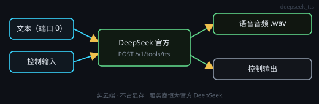

# DeepSeek 语音合成（云端 · 官方 API）

画布右键 → **处理节点 › 音频生成 › DeepSeek 语音合成**（`deepseek_tts`）。把文本交给 **DeepSeek 官方** `POST /v1/tools/tts`（流式档走 `WSS /v1/tools/tts`）合成语音，**每次运行产出一个 `.wav` 文件**。

服务商**不可选**：节点恒取「设置 · 模型服务」里那条**官方 DeepSeek**（`id = deepseek`，`https://api.deepseek.com`）。没配 Key / 填的是第三方中转，节点在本地就停下并指路，不会悄悄换服务商。

## 端子
- **输入**：端口 0 = 待合成文本 · 端口 1 = 控制输入
- **输出**：端口 0 = 语音音频（`.wav`，下游可试听 / 保存 / 接语音识别）· 端口 1 = 控制输出

## 运行
- 节点头部的 **▶** 直接跑这一颗（等价于点保存节点的「立即保存」，不必先设工作目录：产物默认落系统临时目录）；控制节点也能指挥它。运行中 ▶ 变成 **…**，跑完卡片上写「已合成：音色 · 通道 · 秒数」。

## 卡片上直接编辑
- 卡片里那块文本框 = 待合成文本。端口 0 有输入时它**只读**回显（线上值优先），空着才可编辑。
- 合成完卡片下方出现播放器，可直接试听产物。

## 设置（节点头部 ⚙ 打开的设置窗口）
- **音色 voice_id**：`stella`（默认，女声）/ `tide`（男声）
- **格式 format**：`wav`（默认，整段一次返回）/ `pcm`（裸 24kHz 16 位单声道；节点仍会替你封装成 `.wav` 落盘）
- **过滤 Markdown filter_markdown**：默认**开**（文档默认 `true`）——合成前把 `#`、`*` 这类记号去掉，免得念出「井号」「星号」
- **合成方式**：**整段**（默认，一次请求拿到完整 wav）/ **流式**（边合成边收 PCM，首字更快；长文本更稳）
- **输出路径**：留空 = 写系统临时目录 `…\Temp\mtnode-ds-tts\`；接了保存节点可留空，由下游取产物
- **超时**：默认 120 秒（5–600）

## 参数端子（端口 9001）
设置里的每一项都可以用「参数」端子覆写，键名：

`voiceId` · `ttsFormat`（`wav` / `pcm`）· `filterMarkdown`（布尔）· `streamMode`（布尔，true = 流式）· `outputPath` · `timeoutSec`

给一颗文本节点写一段 JSON（只写要改的键），连到本节点的参数端子即可。参数端子上的 JSON 有非法键就整份拒绝、本次不运行。

## 注意
- **计费**：按文档的字符计费口径算；单次文本上限 **10000 计费字符**（超过 4 倍直接拦下），更长的文本节点会**自动分段**逐段合成再拼成一个 wav。
- **不进本地媒体串行链、不占显存、不需要安装任何后端** —— 纯云端，断网就报错（不会静默回退本机）。
- **失败口径**（直接写在节点状态里，不猜）：没有 Key / Key 无效 / 文本为空 / 触发内容风控（`Content Exists Risk`）/ 限流 / 服务繁忙 / 超时 / 写文件失败。
- 产物落在用户目录或项目目录，**不写应用安装目录**。
