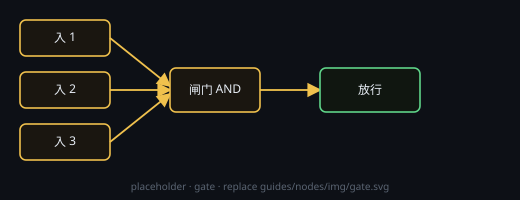

# 闸门

多路输入 **AND**：按设定的输入路数，**每一口**都要收到脉冲才放行一次，放行后到达标记清零；**未接线的口也会挡住放行**。

## 端子
- **输入**：2–8 路（编号固定，断开不会挤位）
- **输出**：控制 1 路

## 设置
- 在节点头部 **⚙ 设置** 打开的设置窗口里改；**输入路数（2–8）**：默认 2
- 节点上只显示一行当前摘要；「清除到达」是节点上的动作按钮

## 用法
- **▶ 强制放行**：忽略到达状态，直接清除标记并放行一次
