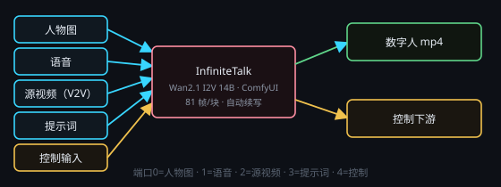

# InfiniteTalk 数字人（Wan2.1 I2V 14B）

画布右键 → **处理节点 › 视频生成 › InfiniteTalk 数字人**。本地数字人后端（独立一份 ComfyUI，默认端口 **8199**）。
输入「一张人物图（或一段源视频）+ 一段语音」，输出**口型同步的 mp4**；**长音频按整段音频自动分块续写**，直到全片结束。
**每次运行只生成一个视频文件**，写入节点自带的 `outputPath`。输出路径也可以留空：把**数据输出**接到下游「保存」节点，路径就归它管（产物先落应用托管目录，再由保存节点落盘）。

## 端子
- **输入**：端口 0 = **人物图**（图像，I2V 用）· 端口 1 = **语音**（音频，必填）· 端口 2 = **源视频**（视频，可空；接了就走 V2V）· 端口 3 = **提示词**（文本，可空）· 端口 4 = **控制输入**（固定最后一颗）
- **输出**：端口 0 = **数字人视频（mp4，已封入原音轨）** · 端口 1 = 控制输出

两种模式二选一：
- **I2V**（端口 2 空着）：用端口 0 的人物图，按所选画幅**居中裁切**适配。
- **V2V**（端口 2 接了源视频）：构图、动作、镜头跟源视频走，按所选画幅缩放；人物图可以同时接上做参考。

人物图可以直接连**图像输入**节点；语音可以直接连**音频输入**节点，或接 **Breeze 语音生成** 节点的输出 ——
任何采样率 / 声道都会先被转成 **16kHz 单声道 wav**，不用自己转码。

## 参数
点节点头部 **⚙ 设置** 打开设置窗口；节点卡片上只显示一行当前摘要（画幅 · 步数）。

- **画幅**：`480p` = 832×480（默认）/ `720p` = 1280×768（更慢、更吃显存）。
- **采样步数**：默认 **4 步**（lightx2v 蒸馏档，cfg 1.0 / euler / simple）。调到 8 以上只会明显变慢，收益有限。
- **种子 / 摇数（每次执行种子 +1）**：同一次运行内所有分块按块递增种子。
- **提示词**：端口 3 没接文本时才用这里；留空 = 内置默认（人物自然说话）。
- **负面提示词**：留空 = 宿主默认（模糊 / 变形 / 多手多指…）。
- **输出路径**：`.mp4` 保存位置（相对工作目录 / 节点层子文件夹）。接了保存节点就可以留空。

## 长音频怎么走
- 视频时长**跟随整段语音**，没有「最多 N 秒」的上限。
- 宿主把语音每 **81 帧（25fps ≈ 3.24 秒）** 切一块：第一块用你给的图 / 源视频，之后每块用**上一块的末帧**
  当参考图、并把上一块**末 9 帧**作为 `previous_frames` 续写，保证人物、构图、机位与口型连续。
- 每块完成后立刻落盘到 `<数据目录>/infinitetalk-local/jobs/<任务id>/`；中途取消 / 后端挂了，
  再点一次 ▶ 会**从断点续跑**（已完成的块不重跑），最后把各块拼成一个 mp4 并封回**原始音轨**。
- 已知取舍：这是**宿主侧窗口级续写**，不是模型内部一次长序列，块边界可能有轻微接缝。

## 优化项（默认全开）
- **fp8 扩散模型** + **lightx2v 4 步蒸馏**：480p 起跑更快、显存更省。
- **SageAttention**：后端以 `--use-sage-attention` 启动；安装时 **SageAttention 装不上就算安装失败**（不会悄悄退回 SDPA）。
- **显存水位**：`--reserve-vram 1.0`；720p 或控制台选「低显存」时追加 `--lowvram`。

## 注意
- 全局同一时刻只允许 **1 个音视频任务**（与音乐 / 视频节点互斥）；抢不到锁时状态行会写明被谁占着。
- 安装建议预留 **≥55GB** 磁盘；本插件**不设显存门槛**，装得下就试，跑不动看控制台日志。
- 首次使用要先装后端：插件卡片「安装」或控制台「安装 / 重装」；装完可在控制台「试生成」先验一遍。
- 后端没运行时点 ▶ 会自动拉起，**跑完不会自动关**（下次生成直接复用；也可在控制台手动停止）。
- 卸载插件**不删**安装目录里的分块产物与已生成的 mp4（需自行清理）。
- 后端报错会弹错误报告（错误码、日志尾部、出问题的节点）并给「自动修复」入口；
  主动取消、正在安装、没有 N 卡这几类只报告不建议自动修。
