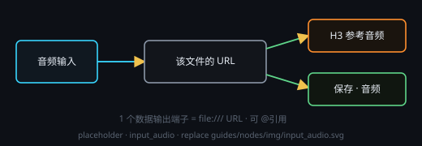

# 音频输入

放一段本机音频当素材：点「选择音频」、把文件拖进来，或用麦克风现场「录制」。

## 端子
- **输入**：1 个数据端子 + 末位控制端子；接上线时内容改为继承上游那份音频（只读，拔线恢复本节点文件）
- **输出**：固定 2 个数据端子
  - **音频输出**：该文件的 `file:///` URL（中文与空格自动百分号编码）
  - **转写输出**：本节点「转录」出来的文字；还没转 / 没转出内容时是空文本

## 设置
- 没有 ⚙ 设置窗：文件、录制、转录都在板身的操作行上。

## 用法
- 点「选择音频」选文件（mp3 / wav / ogg / flac / m4a / aac 等），或直接把文件拖到节点。
- 点「转录」用本机 SenseVoice 转成文字；结果可改、可重转。
- 把「音频输出」接进 Minimax H3 的参考音频端子，或接「保存」节点落盘；`@` 引用给的也是这个 URL（有转录时改用文字）。

## 注意
- 只记原始绝对路径，不复制进工作流资产；文件移走后要重新选。
- 录制走系统默认麦克风，落 `<工作目录>/recordings/record_{yyyymmddhhmmss}.mp3`（128 kbps · 44.1 kHz · 单声道）；同秒重名追加 `_2`、`_3`。没设工作目录会先提示去设置。
- 录制会替换当前文件并清空旧转录；要文字就再点一次「转录」。
- 板身是波形预览，点波形任意位置从该处试听；拖错类型（比如视频）只提示，不改节点内容。
