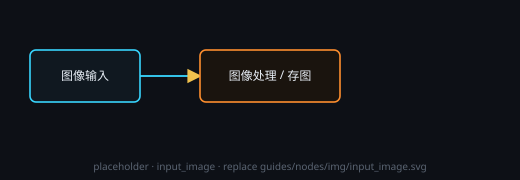

# 图像输入

放入本机图片当素材，输出给图像处理或存图节点。

## 端子
- **输入**：1 个数据端子 + 末位 1 个控制端子；接上游后只读继承上游那张图
- **输出**：1 个 = 图像（批量时是一批图）

## 设置
- 没有 ⚙ 设置窗：选图与批量开关都在节点板身 / 头部。

## 用法
- 点「选择图像」或把图片拖到节点上（png / jpg / jpeg / webp / gif / bmp）。
- 批量：点头部 **批量**，再逐张「＋ 添加图像」；要改回单张点 **拆**。
- 点图可预览大图；「清除」清空当前图。

## 注意
- 图片会复制进工作流资产，长边缩到 1080 以内；原图不动。
- 文件被移走后要重新选一次。
