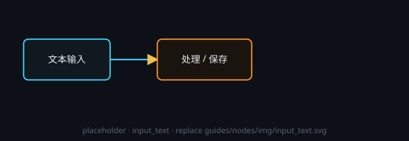

# 文本输入

在节点里直接写文本，作为下游的文本来源。

## 端子
- **输入**：1 个数据端子 + 末位 1 个控制端子；接上游后本节点变为只读继承，自己写的正文不参与取值
- **输出**：1 个 = 文本；上游给的是 YAML / JSON 时按多条（批量）展示，下游可逐条或聚合

## 设置
- 没有 ⚙ 设置窗：正文、字号、JSON 视图都在节点头部与板身上直接改。

## 用法
- 点板身输入框写正文；失焦后按 Markdown 渲染。
- 点头部 **✎** 打开 Markdown 编辑器：所见即所得 / 源码两档，带批注与「让 AI 依据批注修订」。
- 点头部 **A** 调正文字号；纯 JSON 正文可用头部 **JSON** 芯片切换表单视图。
- 继承来的内容符合 YAML 时自动变成批量条目，可点 **YAML** 芯片关掉解析只看原文；老批量节点可用 **拆** 拆回单条。

## 注意
- 接了上游就只读：要改回自己写的正文，先断开入线。
- 在 Markdown 编辑器里插图会把图片复制进画布工作目录的 `assets/`，正文用相对路径引用；没设工作目录时先让你选一个。
- 批量条目里的图片同样落在工作流资产里，不写本机绝对路径。
