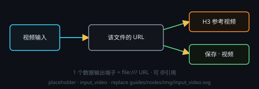

# 视频输入

放一段本机视频当素材：点「选择视频」，或直接把文件拖到节点上。

## 端子
- **输入**：1 个数据端子 + 末位控制端子；接上线时内容改为继承上游那份视频（只读，拔线恢复本节点文件）
- **输出**：固定 2 个数据端子
  - **视频输出**：该文件的 `file:///` URL（中文与空格自动百分号编码）
  - **转写输出**：本节点「转录」出来的文字（按视频音轨转）；还没转 / 没转出内容时是空文本

## 设置
- 没有 ⚙ 设置窗：选文件与转录都在板身的操作行上。

## 用法
- 点「选择视频」选文件（mp4 / webm / mov / mkv / avi 等），或直接把文件拖到节点。
- 点「转录」用本机 SenseVoice 转文字；结果可改、可重转。
- 把「视频输出」接进 Minimax H3 的参考视频端子，或接「保存」节点落盘；`@` 引用给的也是这个 URL（有转录时改用文字）。

## 注意
- 只记原始绝对路径，不复制进工作流资产；文件移走后要重新选。
- 预览走系统播放器内核，编码不支持时只显示提示文字。
- 要生成视频：实拍感用「视频生成 › Minimax H3」，动效用「视频生成 › Remotion 视频」。
