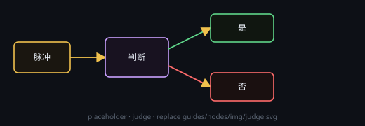

# 判断

用文本模型裁决「目标是否达成」：达成走上面那口，没达成走下面那口。

## 端子
- **输入**：控制脉冲
- **输出**：上 = **是**，下 = **否**

## 用法
- 节点上的「判断标准」文本框可以留空，留空就用所属任务的目标当判据
- 连进来的文本会一并交给模型当已有结果

## 注意
- 本机没有带 API Key 的文本服务商时判断不起跑，任务会进入「需干涉」。
