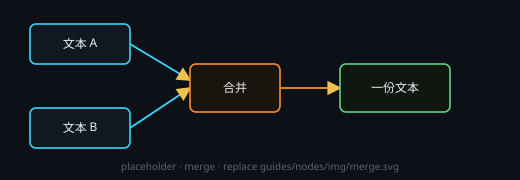

# 合并

把多个节点的结果合成一整批：每个输入 = 批次里的一项，供下游按批处理。

## 端子
- **输入**：可多接（文本 / 图像内容）。
- **输出**：1 个 = 合成后的批次（下游按条目号取其中一项）。

## 设置
- 无设置项：节点头部没有 **⚙ 设置** 窗口；body 上只显示「✓ 已合并 N 项 → 输出为批次」和只读条目列表。

## 注意
- 只收文本与图像；音频 / 视频 / 文件不会进批次。
- 还没接入时 body 显示「○ 等待输入（每个输入 = 批次中的一项）」，输出为空。
- 只要有上游往这里汇入，下游就按批处理 —— 合并节点的输出恒为批次。
