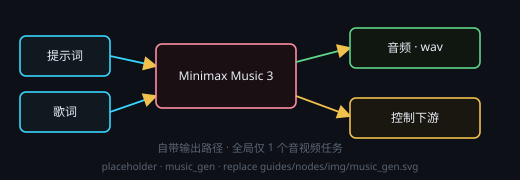

# Minimax Music 3（音乐生成）

画布右键 → **处理节点 › 音频生成 › Minimax Music 3**。本地 MiniMax Music 3 后端（Gradio），按提示词 + 歌词生成一首歌；**每次运行只生成一个音频文件**（`.wav`），写入节点的输出路径。

## 端子
- **输入**：端口 0 = 提示词 · 端口 1 = 歌词（可选；不接则按纯器乐 `[instrumental]` 生成）· 端口 2 = 控制输入
- **输出**：端口 0 = 音频（下游可试听 / 保存）· 端口 1 = 控制输出

## 设置
- 在节点头部 **⚙ 设置** 打开的设置窗口里改。
- **输出路径**：`.wav` 保存位置（相对工作目录 / 节点层子文件夹）；把数据输出接到下游「保存」节点后可以留空 —— 那时产物先落应用托管目录，再由那个保存节点落盘。没接保存节点时必填，留空点 ▶ 会提示「未设置输出路径时无法启动生成」。
- **时长（秒）**：10–150（默认 60）
- **抽卡次数**：连续生成次数（1–10），多次时输出命名为 `#1`、`#2` …
- **种子**：固定种子可复现 · **摇数（每次执行种子 +1）**：默认开
- **auto CPU offload（24G 推荐）**：默认开，24G 显卡建议保持

## 用法
- 提示词接端口 0（歌词接端口 1）→ 设输出路径或接保存节点 → 点 ▶。

## 注意
- 全局同一时刻只允许 1 个音视频任务（音乐 / 视频互斥），其它任务排队；后端实例全局只有一个，多个音乐节点共用。
- 歌词与风格提示词用**内置技能** `minimax-music-lyrics`（端口 1）/ `minimax-music-prompt`（端口 0）：**不用再去创意工坊下载**，会话里打 `/minimax-music-prompt 你的想法` 即可；风格提示词固定产出**一段六句英文散文**（曲风+情绪 → 速度与律动 → 乐器 → 人声 → 段落对比 → 制作混音）。
- **插件报错弹窗**：后端装坏 / 跑挂时弹错误报告并给「🤖 自动修复」，按技能 `minimax-music3-install` 在本插件 INSTALL_DIR 里修，修好自动重启后端；主动取消、安装中、磁盘不够、没 N 卡这类只报告不自动修。
