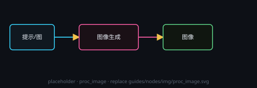

# 图像生成

按提示词生成图像，可接文本或图像输入。标题栏还有三颗开关：蒙版局部重绘、透明背景、与首参考图保持一致长宽比（画幅锁定）。

## 端子
- **输入**：文本或图像（接多张时，第 1 张是蒙版与画幅锁定的基准）
- **输出**：图像

## 设置
在节点头部 **⚙ 设置** 打开的设置窗口里改，改完即时生效；卡片上只有一行摘要，头部 **◈** 是预览（看真正下发的请求）。

- **服务商 / 模型**：本机已配置的服务商与模型。
- **尺寸**：auto 或 30 档。
- **质量 / 背景**：默认都不传（服务商按 auto），取值范围见下节。

## 质量 Quality / 背景 Background
- **Quality**：默认不传；可选 auto / low / medium / high / xhigh / max。只认这六个，旧 DALL·E 的 standard / hd 会 400 或被静默按 auto 计费。
- **Background**：默认不传；可选 auto / opaque / transparent。选 transparent 时接口直出带 Alpha 的 PNG（强制 png），提示词自动补「背景必须真透明」，并禁用差分透明按钮。

## 蒙版局部重绘
点标题栏蒙版按钮，单击开 / 关（首次开启直接进编辑器），右键随时重画。透明绿 = 允许模型重绘，其余区域尽量保留。

- 必须连入图像（首张即蒙版背景），蒙版只对第 1 张生效且须同尺寸。
- **出图画幅跟着首张参考图的像素尺寸走**：请求 `size` 钉成首张图像素尺寸，节点自己选的尺寸这轮不生效；想换画幅先关蒙版。
- 服务商须为 OpenAI 兼容（`/images/edits`），其它类型运行会报错；与画幅锁定同开时以蒙版为准，运行跳过补边。
- 蒙版不是硬裁剪，是引导式编辑：蒙版外的阴影 / 光照可能联动，把标记比目标物体稍微放大一圈更稳。

## 用法
- **透明背景（双通道差分抠图）**：点灰白格开关，每次出 2 张（纯黑基准 + 纯白复刻），Token 与耗时约 2 倍。右键调噪点地板 / 边缘羽化 / 自动对齐，也可用已存两通道重算。只有能把基准图当参考图下发的服务商（OpenAI 兼容 / Stability）才抠图，其余跳过并只交付第 1 通道。
- **画幅锁定**：点虚线画幅按钮，自动把第 1 张参考图等比缩放居中补边 → 按目标画幅生图 → 出图后按同一矩形裁回，长宽比 = 首参考图。需至少一张参考图，纯文生图自动跳过；不多花一次出图。右键选目标画幅（自动 / 跟随节点「尺寸」）、补边方式（边缘延展 / 镜像 / 纯白 / 纯黑 / 自定义色）、输出还原原始像素（默认关）。

## 注意
- 背景选 transparent 与差分抠图互斥：前者会自动关掉后者，按钮置灰。
- 裁回失败退回整幅原图并提示；第 2 通道失败交付第 1 通道原图，都不会把已花钱出的图丢掉。
