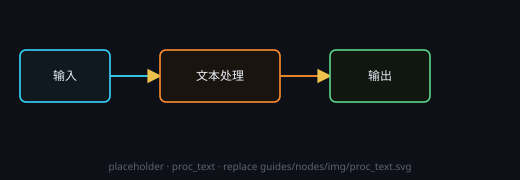

# 文本处理

用大模型按提示词处理上游文本。要读文件 / 联网时打开「智能助手」，它就会以 agent 方式运行。

## 端子
- **输入**：文本（可多路 / `@节点名` 引用其它节点输出）
- **输出**：处理后的文本
- **组**（开启「智能助手」后才有，左排最末位空心方框）：接画布组框的 **□** 或节点层的**组输出**端子，拿到一份清单（标题 + 类型 + 描述 + 节点 id）。来源是节点层时按层级缩进列出内部节点。一个组输入口可接多个来源；接组线不会运行来源节点，要正文时 agent 会按 id 自己去读。输入优先级：组输入 → 画布 → 项目文件 → 外部知识，提示词里明说的要求永远最前。

## 设置
在节点头部 **⚙ 设置** 打开的设置窗口里改，节点卡片上只显示一行当前摘要：

- **服务商 / 模型**：随便挑本机已配置的。
- **温度**：0–2，默认 0.7。

提示词属于内容，仍写在节点里；头部 **◈** 是预览，看运行时真正发出去的请求。

## 注意
- 思考与输出分开显示：思考折成 **「◉ 思考 · N 字」**（N 只数思考字数），**🔧 工具**调用就近插在发生位置；输出端子给下游的仍是完整正文。
- 没开「智能助手」时不会读文件、不会联网，只按文本作答。
