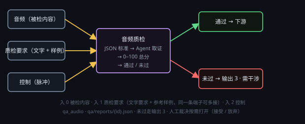

# 音频质检

按一份 JSON 评分标准给音频打分：每维 0–100 分，按权重加权成 0–100 总分，再按模板的合格线判「通过 / 未过」。只判不返工。

## 端子
- **输入**：3 个 —— 0 被检内容（语音生成节点的音频，或音频文件路径）、1 质检要求（可多线：文字口径 + 参考样例；接了线就由它决定验收口径）、2 控制。
- **输出**：3 个 —— 0 报告（本次完整报告 JSON）、1 通过（控制）、2 未过（控制）。

## 设置
在节点头部 **⚙ 设置** 打开的设置窗口里改（标题「质检标准 / 模型」）：
- **评分标准**：下拉选一份 JSON 模板（默认 `builtin/audio-general`），下面只读显示合格线与各维权重；**刷新** 重扫模板目录，**打开模板目录** 打开 `<数据目录>/qa-templates/`。
- **质检模型**：服务商 + 模型。
- **思考强度**：默认「无」。

## 用法
- 音频接 0 号口，台词 / 要求接 1 号口，点 ▶。
- body 里的 JSON 就是本次判据，可直接改（只影响这一颗节点）；想复用点「保存为新模板」，改坏了点「恢复模板」。入 1 接了线，这份 JSON 变只读。

## 注意
- 模型本身听不了音频：先用 `transcribe` 让本机 SenseVoice 逐句转写（带时间戳），「内容对不对 / 有没有漏读错读」都拿它和 1 号口的台词逐句比；音色 / 情绪的结论也只能建立在转写 + 指标 + 台词上，证据不足就少给分。
- 响度 / 噪声 / 削波用 `probe` 和 `shell`（ffmpeg 的 `volumedetect` / `ebur128`）拿具体数值，例如「-16 LUFS 附近」。证据写到第几句 / 第几秒 + 转写原文或 dB 值。
- 判 fail 只置「需干涉」并走「未过」，不重跑上游、不自动弹卡；要放行就点「人工裁决」→ **接受（人工放行）** / **放弃（判失败）**。质检模型和上游生成节点同款时直接拒跑（生成者不自评）。
- 模板三处（随包只读 / `<数据目录>/qa-templates/` / `<工程根>/qa/templates/`，同名后者覆盖前者），`kind` 要对上 `audio`（或 any）；报告写到 `<工程根>/qa/reports/{id}.json`。
