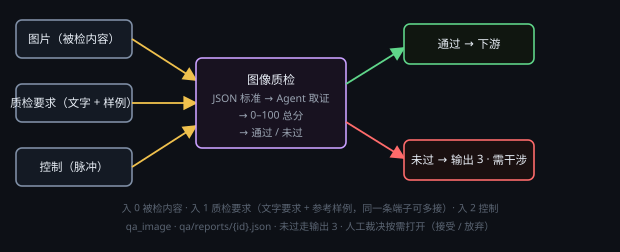

# 图像质检

按一份 JSON 评分标准给图片打分：每维 0–100 分，按权重加权成 0–100 总分，再按模板的合格线判「通过 / 未过」。只判不返工。

## 端子
- **输入**：3 个 —— 0 被检内容（出图节点的图像，或图片文件路径）、1 质检要求（可多线：文字口径 + 参考样例；接了线就由它决定验收口径）、2 控制。
- **输出**：3 个 —— 0 报告（本次完整报告 JSON）、1 通过（控制）、2 未过（控制）。

## 设置
在节点头部 **⚙ 设置** 打开的设置窗口里改（标题「质检标准 / 模型」）：
- **评分标准**：下拉选一份 JSON 模板（默认 `builtin/image-general`），下面只读显示合格线与各维权重；**刷新** 重扫模板目录，**打开模板目录** 打开 `<数据目录>/qa-templates/`。
- **质检模型**：服务商 + 模型，要选能看图的（服务商没开视觉，图片不会随请求下发）。
- **思考强度**：默认「无」。

## 用法
- 被检图接 0 号口，参考样例（角色三视图 / 场景设定图）接 1 号口，点 ▶。
- body 里的 JSON 就是本次判据，可直接改（只影响这一颗节点）；想复用点「保存为新模板」，改坏了点「恢复模板」。入 1 接了线，这份 JSON 变只读。

## 注意
- 首轮就把原图（连同 1 号口的参考样例图，最多 8 张）发给模型，整体判断可以直接下；局部瑕疵（手指、文字、眼睛、接缝）要用 `vision` 工具指定「只看手 / 只看文字」再看一遍。
- 一致性维度要靠 1 号口的参考样例；没接就只按图片自身是否自洽判，不凭空猜「和设定不像」。尺寸 / 比例用 `probe` 拿证据。
- 判 fail 只置「需干涉」并走「未过」，不重跑上游、不自动弹卡；要放行就点「人工裁决」→ **接受（人工放行）** / **放弃（判失败）**。质检模型和上游生成节点同款时直接拒跑（生成者不自评）。
- 模板三处（随包只读 / `<数据目录>/qa-templates/` / `<工程根>/qa/templates/`，同名后者覆盖前者），`kind` 要对上 `image`（或 any）；报告写到 `<工程根>/qa/reports/{id}.json`。
