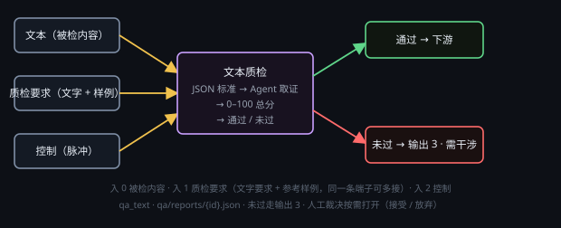

# 文本质检

按一份 JSON 评分标准给文本打分：每维 0–100 分，按权重加权成 0–100 总分，再按模板的合格线判「通过 / 未过」。只判不返工。

## 端子
- **输入**：3 个 —— 0 被检内容（文本节点的正文，或 .md / .txt / .json 路径）、1 质检要求（可多线：文字口径 + 参考样例；接了线就由它决定验收口径）、2 控制。
- **输出**：3 个 —— 0 报告（本次完整报告 JSON）、1 通过（控制）、2 未过（控制）。

## 设置
在节点头部 **⚙ 设置** 打开的设置窗口里改（标题「质检标准 / 模型」）：
- **评分标准**：下拉选一份 JSON 模板（默认 `builtin/text-general`），下面只读显示合格线与各维权重；**刷新** 重扫模板目录，**打开模板目录** 打开 `<数据目录>/qa-templates/`。
- **质检模型**：服务商 + 模型。
- **思考强度**：默认「无」。

## 用法
- 被检内容接 0 号口，要求 / 参考样例接 1 号口，点 ▶。
- body 里的 JSON 就是本次判据，可直接改（只影响这一颗节点）；想复用点「保存为新模板」，改坏了点「恢复模板」。入 1 接了线，这份 JSON 变只读。

## 注意
- 判据全在模板里：`<应用目录>/qa-templates/`（随包只读）、`<数据目录>/qa-templates/`、`<工程根>/qa/templates/` 三处，同名后者覆盖前者；`kind` 要与节点类型对上（text / image / video / audio / file，或 any）。总分 = Σ(维度分 × `weight`) / Σ`weight`；`passLine` 是合格线，`minScore` 是该维硬失败线（可省）。
- 判 fail 只置「需干涉」并走「未过」，不重跑上游、不自动弹卡；要放行就在节点上点「人工裁决」→ **接受（人工放行）** 记 manualOverride 转通过、不重触发下游，或 **放弃（判失败）**。
- 质检模型和上游生成节点用同一个模型时直接拒跑（生成者不自评）。Agent 循环没有轮数上限，只能手动停；连续 3 次回包解不出 JSON 才中止；blocked 只置「需干涉」，绝不写 pass。
- 首轮只带前 8000 字正文和 6000 字要求，长文要让模型自己用 `read` 分段读完再打分。报告写到 `<工程根>/qa/reports/{id}.json`，pass / fail 还会回写语义工程 `manifest.json` 的 `shots[id].qa`。
