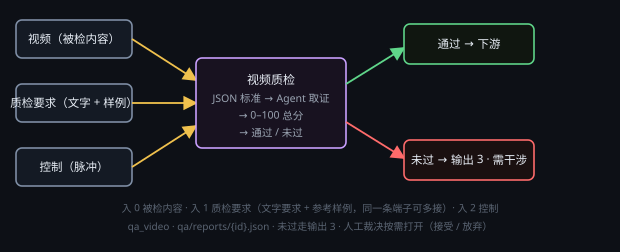

# 视频质检



按一份 **JSON 评分标准** 给视频（抽帧 + 硬指标）打分（每维 0–100，按权重加权成 0–100 总分），然后**自动过关或上门禁**：总分 ≥ 模板 `passLine` 且没有维度低于自己的 `minScore` → 走「通过」；否则置「需干涉」并走「未过」—— 不重跑上游、不自动弹卡，要放行就点节点上的「人工裁决」。报告落到 `<画布工作目录>/qa/reports/{id}.json`。

对应缺口文档 `docs/text-to-video-pipeline-gap.md` 的 P0-4：把「评审」从**同节点同模型自评**换成
**独立模型 + 显式判据 + 人工兜底**。判据不写死在代码里 —— 换一套标准 = 换一个模板文件。

## 端子（五类质检完全同构）

**输入**
- **0 被检内容**：要检查的视频：视频生成节点 / 数字人节点的产物，或一个视频文件路径。
- **1 质检要求**：一条端子可接多条（数组收），同时收两类东西：
  - **文字口径**：要求 / 脚本 / 镜头规格 JSON —— 模型会把它当**优先于主观偏好**的依据；
  - **参考样例**：设定图、样片、基准文本 / 文件 —— 用来比一致性、比对是否照做；送审条数受 ⚙ 的
    「送审参考样例上限」限制（文字不受限，全部送）。这一端子就是以前的「要求 / 脚本 + 参考基准」，
    两者已经合并，不再有单独的参考基准端子。
- **2 控制**：控制脉冲入口。

**输出**
- **0 报告**：本次质检的完整报告 JSON（含判定、总分、每维分数与理由、用过的工具、轮数）。
- **1 判定**：`pass` / `fail` / `blocked` 文本。
- **2 控制·通过**：判定为 pass 时走这一路。
- **3 控制·未过**：判定为 fail 时走这一路（blocked 不进控制流，只置「需干涉」）。

## 评分标准（模板）

模板是纯 JSON，放在三处，**同基本名后者覆盖前者**：

| 位置 | 用途 |
| --- | --- |
| `<应用目录>/qa-templates/` | 随包内置（只读） |
| `<数据目录>/qa-templates/` | 你自己的全局标准（⚙ 里「打开模板目录」直接打开） |
| `<工程根>/qa/templates/` | 只对这一工程生效 |

```json
{
  "version": 2,
  "kind": "video",
  "title": "示例标准",
  "description": "一句话说明这份标准用在什么场合",
  "passLine": 80,
  "dimensions": [
    {
      "id": "维度 id（要给分，必须是这个 key）",
      "title": "维度名称",
      "weight": 1,
      "minScore": 60,
      "criteria": "这一维的评分细则：什么样给 60、80、90，检查什么，别写成空话"
    }
  ]
}
```

- 总分 = Σ(维度分 × `weight`) / Σ`weight`，落在 **0–100**。
- `passLine`：合格线；`minScore`：该维度的硬失败线（可省略）。
- `kind` 必须与节点类型对得上（`text` / `image` / `video` / `audio` / `file`，或 `any`）；写错了 ⚙ 里会直接报不合法。
- 改完模板点 ⚙ 里的「刷新」重新扫描，不用重启。

## Agent 怎么打分

节点跑的是**一个带工具的多轮循环**：模型自己决定看什么 → 调工具拿证据 → 够了就给 `final`。
没有轮数上限、没有超时，**只能手动停**（■）；连续 3 次回包无法解析才中止。

| 工具 | 干什么 |
| --- | --- |
| `list` | 列一层目录（路径、大小） |
| `read` | 读文本文件，`offset` / `limit` 分段 |
| `grep` | 在目录 / 文件里搜正则，返回命中行 |
| `vision` | 把图片交给视觉模型细看（可指定「只看什么」） |
| `probe` | ffprobe：时长 / 分辨率 / 帧率 / 码率 / 黑帧段 |
| `frames` | 按时间点抽帧成 PNG（上限 12 张，下一轮自动带上） |
| `transcribe` | 本机 SenseVoice 逐句转写（带时间点） |
| `pdf` | PDF 文本层 → Markdown |
| `web` | 搜索 / 抓网页正文 |
| `shell` | 在本机跑一条命令（180 秒上限） |
| `write` | 落中间产物 |

11 个工具**恒开**，节点上没有工具开关。

### 这一类的取证要点

- **节点会先自动抽帧**（默认 7 张，⚙ 里 1–12 可调），首轮就连同这些帧一起发给模型 —— 这是「看得见画面」的基础；抽帧失败会直接判 blocked，不会瞎猜。
- **证据要带时间点**：说「第 3 秒人物手部变形」比「有瑕疵」有用得多；需要看得更细时用 `frames` 指定 `times` 重抽某几秒，再用 `vision` 单独看。
- **硬指标只当证据、不改分数**：`probe` 给的时长 / 分辨率 / 帧率 / 黑帧段写在报告的 `probe` 里；某项不达标是否扣分，由模板的维度定义说了算。
- **口型 / 语音类视频**：先 `transcribe` 拿到台词时间轴，再和画面对照（「这句台词时嘴在动吗」）。

证据写到帧时间点（t=…s）+ 画面里看到的事实，或 probe 的具体数值。

## 判定与失败之后

1. **pass**：走输出 2，下游照常。
2. **fail**：节点转「需干涉」，报告写 `fail`，走「未过」控制出（输出 3）。
   **不自动重跑上游、不弹卡** —— 质检节点只判不返工，重做上游是用户自己的事。
3. **要放行**：点节点 body 上的「**人工裁决**」→ 卡里只有两个选择：
   **接受**（报告记 `manualOverride`、转「通过」，**不重触发下游**）/ **放弃**（判失败）。
4. **blocked**（模型调不通 / 回包解不出 JSON / 某维没给分 / 抽帧失败）：只置「需干涉」+ 报告写 blocked，
   **绝不写 pass**。

**生成者不自评**：质检用的模型与上游生成节点相同时**直接拒跑**并点名，请换一个模型。

## 设置（⚙）

评分标准（下拉选模板 · 只读展示合格线与各维权重）· 质检模型（服务商 + 模型）·
抽帧数 · 送审参考样例上限。没有工具开关、没有重试次数。

## 在节点上改评分标准

body 里默认把当前模板的**整份 JSON** 摊成表单（「表单 ↔ 源码」可切，和文本节点的 JSON 渲染同一套），可以直接改：

- 改动存进节点字段 `qaTemplateJson`，**只影响这一颗节点**（模板文件一个字都不改）。表格超出可下拉滚动。
- body 上只写运行结果（总分 / 判定）和这份 JSON，**不挂任何说明文字**；「旧图需重连」只在接错端口时冒一行。
- 想复用就点「**保存为新模板**」：写进 `<数据目录>/qa-templates/`（同名自动加 `-2`），并立刻切成新模板。
- 点「**恢复模板**」丢掉节点内的改动，回到模板库那一份。
- **只读条件**：入 1「质检要求」接了线 → body 里的 JSON 变只读（验收口径由连线决定）；入 0 被检内容不算。

## 报告

`qa/reports/{id}.json`（`round` 恒为 1），`schema:2`：

- `verdict` / `verdict_why` / `score`（0–100，另有 `score01` 归一值给老消费方）/ `passLine`；
- `criteria`：当时用的模板**快照**（之后换模板也能复现判据）；
- `dimensions[]`：每维的 `score` / `reason` / `evidence`；`defects[]`；`fix_plan`；
- `tools_used` / `turns` / `transcript`（证据流水）/ `probe` / `frames`。

判定为 pass / fail 时还会回写语义工程 `manifest.json` 的 `shots[id].qa`（fail 会把该镜头标 stale 并记 `qa_failed`）。
