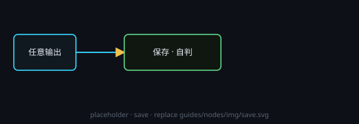

# 保存

一颗节点按连进来的内容自判落盘类型：文本 → `.md`（批量 / 聚合条目仍用 `.yaml`）、图像 → `.png`、音频（音乐生成）→ `.wav`、视频（视频生成）→ `.mp4`。

## 端子
- **输入**：文本 / 图像 / 音频 / 视频，按来源自判；还没连上输入时类型未定，落盘前不猜后缀。
- **输出**：1 个 = **本次保存的内容**（数据端子）：文本保存给最后写盘的正文，图像 / 音频 / 视频保存给最后落盘的文件，PDF 生成给落盘的 PDF 地址；还没保存过 → 先给上游输入的内容，可以继续往下接，也能被 `@` 引用（文本类）。

## 设置
- **文件名**直接在节点卡片上改：只换路径最后一段，旁边小片显示会补的后缀（`.md` / `.png` / `.wav` / `.mp4`），回车 / 失焦提交、Esc 撤销。
- 在节点头部 **⚙ 设置** 打开的设置窗口里改：
  - **保存路径**：相对工作目录或绝对路径，后缀由输入类型固定、写错会自动纠正；在设了子文件夹的**节点层**内时相对路径落在该子文件夹下。
  - **输入变化时自动保存**：上游输出更新就重存（默认开）。
  - **图像输出（尺寸 / 裁剪 / 格式 / 质量）**：只在按图像保存时出现，点「图像输出设定…」开面板，默认「原样 + PNG」。

## 用法
- 接上上游、填好保存路径，点 ▶ 落盘；节点上的 **浏览 / 位置 / 打开** 是动作按钮。
- 放置**音乐生成**或**视频生成**时会在其右侧自动绑定一颗保存节点（相对位置固定、连线不可删除），生成节点把文件名写进它。

## 注意
- 保存路径留空时点 ▶ 只提示「请先指定保存路径（可用「浏览」选择）」。
- 上游生成节点（音乐 / 语音 / 视频生成、视频超分 / 补帧）的输出路径可以留空：把它的数据输出接到本节点，产物先落应用托管目录，再由本节点按自己的保存路径落盘；没接本节点时上游仍必须自己填输出路径。
- 图像输出面板里**质量** 0.1–1.0，只在 JPG / WebP 生效，透明区自动填白；批量 / 多图每个文件套同一套设定，聚合模式只写第一条中的第一张图。
- 保存 → 保存不会自动级联，下游那颗仍需自己点 ▶。卡片文本预览只贴前两万字，二进制与 4MB 以上文件只写一行说明。
