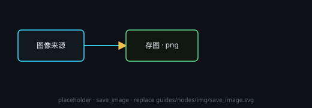

# 保存图像（已合并）

已并入统一的「保存」节点：新建时直接建成 `save`，旧画布打开时 `save_image` 也会升级，图像固定 `.png`。

## 端子
- **输入**：图像。
- **输出**：1 个 = 最后落盘的那个文件（与「保存」节点一致）。

## 设置
- 用「保存」节点那一套：节点头部 **⚙ 设置** 里有**保存路径**、**输入变化时自动保存**，以及图像专有的**图像输出**设定。

## 注意
- 这个类型已不能新建，细节见「保存」。
