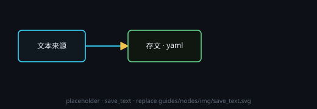

# 保存文本（已合并）

已并入统一的「保存」节点：新建时直接建成 `save`，旧画布打开时 `save_text` 也会升级，文本仍按 `.yaml` 批量口径落盘。

## 端子
- **输入**：文本。
- **输出**：1 个 = 本次保存的内容（与「保存」节点一致）。

## 设置
- 用「保存」节点那一套：节点头部 **⚙ 设置** 里有**保存路径**与**输入变化时自动保存**。

## 注意
- 这个类型已不能新建，细节见「保存」。
