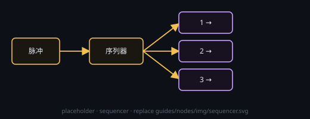

# 序列器

一路入、多路出：脉冲到达后**按顺序**点燃输出 1…N，可留步间间隔（全 0 就立即接续）。

## 端子
- **输入**：控制
- **输出**：2–8 路（带编号）

## 设置
- 在节点头部 **⚙ 设置** 打开的设置窗口里改；**输出路数（2–8）**：默认 3
- **步间间隔（天 / 时 / 分，可全 0）**：默认 0，即无间隔
- 节点上只显示一行当前摘要
