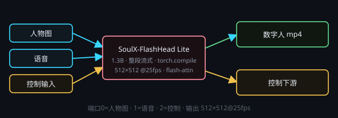

# SoulX 实时数字人（SoulX-FlashHead Lite 1.3B）

画布右键 → **处理节点 › 视频生成 › SoulX 实时数字人**。本地**实时**数字人后端（独立 Python 服务，默认端口 **8198**）。
输入「一张人物图 + 一段语音」，输出 **512×512 @25fps 口型同步 mp4**；整段音频**一次流式跑完**，中间不切块、不拼缝。
**每次运行只生成一个视频文件**，写入节点自带的 `outputPath`。输出路径也可以留空：把**数据输出**接到下游「保存」节点，路径就归它管（产物先落应用托管目录，再由保存节点落盘）。

## 端子
- **输入**：端口 0 = **人物图**（图像，必填）· 端口 1 = **语音**（音频，必填）· 端口 2 = **控制输入**（固定最后一颗）
- **输出**：端口 0 = **数字人视频（mp4，已封入原音轨）** · 端口 1 = 控制输出

人物图可以直接连**图像输入**节点；语音可以直接连**音频输入**节点，或接 **Breeze 语音生成** 节点的输出 ——
任何采样率 / 声道都会先被转成 **16kHz 单声道 wav**，不用自己转码。

## 输出口径（固定，不可调）
- **512×512**、**25fps**：官方 Model_Lite 的实时训练口径，长宽比固定，人物图按中心裁切适配。
- 视频时长**跟随整段语音**，没有「最多 N 秒」的上限；模型自己按 33 帧窗口无限长续写。
- 成片直接封入**原始音轨**（aac），不用再合成。

## 参数
点节点头部 **⚙ 设置** 打开设置窗口；节点卡片上只显示一行当前摘要（512×512 · 步数）。

- **采样步数**：默认 **4 步**（官方 lite 蒸馏档）。调到 8 以上会明显掉出实时区，不建议。
- **种子 / 摇数（每次执行种子 +1）**：流式续写时保持同一人物与嘴型节奏。
- **输出路径**：`.mp4` 保存位置（相对工作目录 / 节点层子文件夹）。接了保存节点就可以留空。

## 实时性怎么验
- 安装收尾会跑一次 **4 块真实基准**（加载权重 + 连续出片）：第一块含 torch.compile 预热，**后 3 块取中位数**才是稳态，把 **ms/块 · FPS · RTF** 写进控制台与安装日志（同时记下首块耗时，便于区分预热与稳态）。
- 控制台「试生成」与「实时基准」两条按钮随时可复测；画布节点运行中的状态行也带**稳态** FPS / RTF。
- 实测（单张 RTX 4090、单路、512×512、4 步）：稳态约 **316–800 ms/块**（24 帧），即 **30–76 FPS、RTF 0.33–0.83**；6 秒语音端到端约 10 秒（含加载与预热）。
- 验收口径：**单张 RTX 4090、单路、≥25FPS 稳定**。官方峰值更高只作记录，不作为承诺。

## 优化项（默认全开）
- **torch.compile**：后端默认编译主模型（`MT_FLASHHEAD_COMPILE=1`）；编译失败会自动退回不编译重跑，日志里写明。
- **flash-attention**：安装时**必装**，装不上就算安装失败（不会悄悄退回 SDPA）。默认走匹配 torch 版本的 Windows 预编译轮子，最后才源码编译。
- **SageAttention**：能装就装（`--sage` 走它），装不上只警告、不影响出片。
- **fp16 + VAE 分片**：显存按块释放，16G 卡也能跑。

## 注意
- 全局同一时刻只允许 **1 个音视频任务**（与音乐 / 视频 / InfiniteTalk 节点互斥）；抢不到锁时状态行会写明被谁占着。
- 安装建议预留 **≥30GB** 磁盘；没有 NVIDIA 显卡直接拒绝安装（CPU 跑不到实时，不做降级）。
- 首次使用要先装后端：插件卡片「安装」或控制台「安装 / 重装」；装完可在控制台「试生成」先验一遍。
- 后端没运行时点 ▶ 会自动拉起，**跑完不会自动关**（下次生成直接复用；也可在控制台手动停止）。
- 卸载插件**不删**已生成的 mp4（需自行清理）。
- 与 **InfiniteTalk 数字人**是两颗独立插件：后台服务、安装目录、显存占用各自独立，可以只装一颗。
- 后端报错会弹错误报告（错误码、日志尾部、出问题的节点）并给「自动修复」入口；
  主动取消、正在安装、没有 N 卡这几类只报告不建议自动修。
