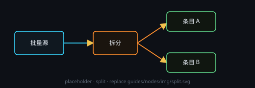

# 拆分

从一整批内容里挑出一条，当成单项交给下游（下游不再按批处理）。

## 端子
- **输入**：1 路批次；再连一根会顶掉旧线（拆分节点仅接受 1 个输入）。
- **输出**：1 个 = 选中的那一项（文本或图像）。

## 设置
- 无设置项：节点头部没有 **⚙ 设置** 窗口；「选择拆出的项」在节点 body 的下拉里选，body 上还显示「输入批次共 N 项」和这一项的预览。

## 注意
- 没选之前下拉是「（请选择）」，输出为空。
- 内容跟着输入实时变：源批次里那条改了 / 删了，这里跟着变；找不到所选标题时输出为空。
