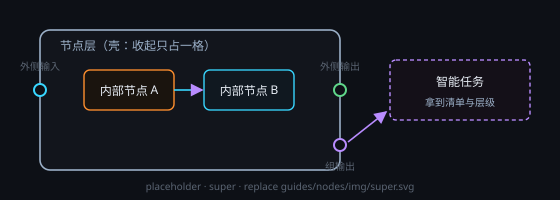

# 节点层

把一组节点收进一个壳里：收起只占一格，展开或 **↪ 进入** 后照原样编辑；跨壳的数据只从边界端子进出。

## 端子
- **外侧输入 / 输出**：收起时对外的接线口，数据线与控制线都走这里
- **内侧桥接（左）/ 内侧汇流（右）**：展开或进入后画布左右缘那两排——外面的数据从左侧桥接端子送进层内，层内的结果从右侧汇流端子流出去
- **组输出**：右侧端子排最末一颗（紫色圆点）。拖到「智能任务」或开了智能助手的「文本处理」节点的组输入端子上，这颗智能节点这一轮就拿到本层全部节点的清单与层级（层自己一行、内部节点缩进；每行 标题 · 类型 · 描述 · 节点 id）；只有清单没有正文，正文要它自己按 id 去取；接这条线不会运行层里的节点，层被删或搬空时自动断开

## 设置
- 没有 ⚙ 设置窗口，都在标题栏改：**子文件夹** 让内部相对路径落到「工作目录 / 子文件夹」下（内部已有的相对路径自动补上这个前缀）；**描述** 与 **封面** 是文件夹标题下的小字和 body 封面图

## 用法
- 顶栏「节点层」把选中节点框进一颗新层；选中单颗层再点一次 = 拆开它（内容按原位移回外层，空壳删除）
- 标题栏：▶ 运行本层（按上游→下游跑完层内可执行节点）、↪ 进入、展开 / 收起；拖入拖出即移进移出；侧栏「节点层」树可快速进入并定位

## 三种形态

| 形态 | 怎么来 | 干什么 |
| --- | --- | --- |
| **开发节点** | 右键「开发节点（项目架构 · 功能块）」里建 | 软件项目架构：模块 → 文件 → 类 / 接口 / 枚举，绑定项目根目录（devPath）；卡片按钮「开发 / 细化 / 打开」，「建议」在右键菜单；元素间用关系线（rel）表达依赖 / 调用 |
| **数据库节点** | 把节点层标成数据库（db）；右键菜单没有单建入口，让画布助手建 | 事实收纳：内部放「文件节点 / 表」，头部 **⚙** 编译生成「数据库副本」，智能节点用 `mtnode_db` 查询 |
| **长任务壳** | 不用手动建：长周期任务创建时就把父壳与各环节子壳摆好（只建不跑；后来新增的环节跑到有产出时补建） | 产出收纳：每条长任务一颗「长任务 · <任务名>」父壳，每个环节一颗子壳，产出 / 产物节点落进对应子壳（头部只读徽标；壳被删不会自动重长，条带「⋯ 更多」里点「重建壳」恢复） |

## 注意
- 层内节点不能直连层外节点：只能经边界端子逐层中转（内侧 → 层的外侧输出端子 → … → 目标层的外侧输入端子 → 内侧）
- 复制带子文件夹的层会弹窗让你改路径，否则一运行就写回原目录、覆盖原内容
- 组输出线只吃智能节点的组输入端子，普通数据端子接不上

详见手册 [节点层](#node-layers)、[开发节点](#dev-nodes)、[数据库节点](#database-nodes)。
