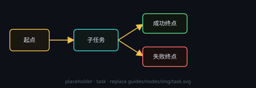

# 任务

一个装控制流图的容器节点：进去是「起点 → 工作 / 子任务 / 判断 → 成功 / 失败终点」，外面一格就代表整段工作。

## 端子
- **输入**：端口 0 = 控制（激活内部起点）
- **输出**：端口 0 = 成功 · 端口 1 = 失败（按内部脉冲最后走到哪类终点，只触发其中一颗）

## 设置
- 没有 ⚙ 设置窗口，都在卡片上改：**任务目标** 就是卡片里的「任务目标 / 本任务要解决什么」文本框

## 用法
- 先写清目标；「＋ 任务」在内部加一颗带起点终点的子任务，或「助手拆解」按目标自动拆成内部任务图；然后点 ▶ 从内部起点发脉冲
- 父级格子会按格显示子任务，点格子直接进那颗子任务

## 注意
- 内部图里没有起点会报「缺少起点」；脉冲哪条终点都没走到，报「控制流未到达终点」并按失败算
- 半路需要人来干涉（blocked）时不算成功也不算失败，两颗输出都不触发
- 成功 / 失败是两颗不同端子，下游要分别接线才收得到对应的那一路
