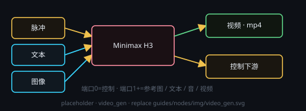

# Minimax H3（视频生成）

画布右键 → **处理节点 › 视频生成 › Minimax H3**。本地 MiniMax H3 后端（ComfyUI），把提示词 + 参考素材生成一段视频；**每次运行只生成一个视频文件**（`.mp4`），写入节点的输出路径。

## 端子
- **输入**：端口 0 = 控制输入（固定第一个，数据线连不上）· 端口 1 = 提示词 · **FL2VA** 模式：端口 2–3 = 首帧 F / 末帧 L · **R2V** 模式：端口 2–10 = 参考图 I1–I9、端口 11–13 = 参考视频 V1–V3、端口 14–16 = 参考音频 A1–A3（三组一次排全）· 开「衔接上一段视频」后多一个 **↩ 上一段视频**（FL2VA = 端口 4、R2V = 端口 17）
- **输出**：端口 0 = 视频（下游可试看）· 端口 1 = 控制输出

## 设置
- 在节点头部 **⚙ 设置** 打开的设置窗口里改。
- **输出路径**：`.mp4` 位置（相对工作目录 / 节点层子文件夹）；数据输出接了保存节点就可以留空，由那个保存节点落盘；没接时必填，留空点 ▶ 会提示「未设置输出路径时无法启动生成」。
- **模式**：`fl2va` 首末帧（默认）/ `r2v` 多参考 · **尺寸比例**：16:9（默认）/ 9:16 / 1:1 / 4:3 / 3:4 / 21:9 · **输出分辨率**：auto（默认，按比例）/ 480p / 720p / 1080p（显存不足自动降档；24G 下长边钳到 ≤1280）
- **时长**：4–15 秒（默认 5）· **采样步数**（默认 20）· **采样器** `res_multistep`（默认）· **调度器** `simple`（默认）· **去噪 denoise**（默认 1）· **帧率**（默认 24）· **位深** 8bit（默认）/ 16bit · **封装** auto / mp4 / webm · **编解码** auto / h264 / vp9
- **抽卡次数**（1–10）· **种子** + **摇数（每次执行种子 +1）**
- **24G 优化（默认全开，可关）**：EasyCache · Sage Attention · Low VRAM Attention · Chunk FeedForward · VAE 前卸模型
- **分段衔接**：勾「衔接上一段视频」→ **引导帧数**（1–60，默认 22）、**重绘幅度**（0–1，默认 1；0.3–0.6 = 引导加重绘）；`r2v` 另有**自动补写续写声明**（默认开）

## 分段衔接怎么用
- H3 单次最长 15 秒；要更长就分段生成：第 1 段正常出片 → 第 2 段起把上一段输出接到 **↩** 端子 → 重复到目标时长 → 在剪辑软件里按顺序拼接。
- `fl2va`：上一段末帧兜底充当首帧（首帧端子接了图则以你接的为准）。`r2v`：上一段末 N 帧占一路参考视频，连满 3 路时**顶掉 V3**，状态行会写明占了第几路。

## 自建 ComfyUI 工作流
- 「工作流来源」选**自建 ComfyUI 工作流**。库在 `<数据目录>/h3-workflows/`，在 H3 管理窗口的「自建工作流库」导入（拖 / 粘 JSON，API 与 UI 格式都认）；「打开」只是在内嵌编辑器里改，不覆盖库里的模板。
- **端子**：数据端子 1 = 文本 · 2+ = 素材（图 / 视频 / 音频），端口 0 仍是控制输入；端子接了数据时端子优先，没接才用设置里的直填值。
- 图里有多个 `Save*` 时用「输出节点」指定取哪个（留空 = 最后一个视频）；种子会下发到图里所有 `seed` / `noise_seed` 字段。
- 自建模式下时长 / 分辨率 / 采样等内置参数一律失效，也不做 24G 钳制。

## 注意
- 全局同一时刻只允许 1 个音视频任务（音乐 / 视频互斥）；24G 显存会限制分辨率档位。
- 本节点只出原生片：超分 / 补帧是独立节点（处理节点 › 视频生成 › 视频超分 / 视频补帧），可串成 **H3 → 视频超分 → 视频补帧**。
- **Sage Attention 是必须项**：`triton-windows` 与配套的 `sageattention` 要成对装，没就绪会拒绝启动后端与出片；把设置里的 Sage Attention 关掉 = 本节点豁免（慢约 1.5–2×，状态行留警告）。
- 参考素材「接上了却没生效」先看状态行：读不到的素材会被点名（如 `I1（参考图）`）且本次不带进请求。
- **插件报错弹窗**：装坏 / 跑挂会弹错误报告并给「🤖 自动修复」，按技能 `minimax-h3-install` 在本插件 INSTALL_DIR 里修，修好自动重启后端；主动取消、安装中、磁盘不够、没 N 卡这类只报告不自动修。
