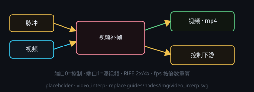

# 视频补帧（RIFE · 独立后处理）

画布右键 → **处理节点 › 视频生成 › 视频补帧**。给**已有视频**单独补帧：RIFE 按倍数插帧，帧率按倍数重算（2x / 4x）；**每次运行只生成一个视频文件**（`.mp4`），写入节点的输出路径。它不跟 Minimax H3 生成一起跑，是**独立后处理**节点。

## 端子
- **输入**：端口 0 = 控制输入（固定）· 端口 1 = 源视频 · 端口 2+ = 可选素材（渐进展开）
- **输出**：端口 0 = 视频（下游可试看）· 端口 1 = 控制输出

## 设置
- 在节点头部 **⚙ 设置** 打开的设置窗口里改。
- **补帧倍率**：`2x`（默认，推荐）/ `4x` / `1x`（仅重编码）；源 24fps 走 2x 得 48fps
- **清缓存间隔（帧）**：每 N 帧清一次缓存（默认 2）· **逐帧批量 batch_size**：默认 1 · **缩放系数 scale_factor**：默认 1.0 = 原分辨率
- **低显存安全档**：默认开（低精度 fp16 + 逐帧 + 极小缓存间隔）
- **抽卡次数**：1–10，多次时输出命名为 `#1`、`#2` … · **输出路径**：接了保存节点可留空

## 注意
- 默认走逐帧流式链（`h3-pack/post/stream_interp.py`）：同一时刻只持有**相邻两帧 + 模型**，每帧算完立刻写盘，常驻内存与视频时长、分辨率、倍率都无关，所以 **16G 内存也能完成 15 秒级视频的 2x / 4x 补帧**。
- 音轨原样带走（只改画面帧率）；首次 OOM 会自动降一档重试一次（精度落 fp32）。
- 脚本 / venv / RIFE 权重缺失或流式链非 OOM 失败时才**已回退图路径**（控制台写明原因），那时整段帧数组攒在内存里，更吃 RAM。
- 全局同一时刻只允许 1 个音视频任务（音乐 / 语音 / 视频 / 超分 / 补帧互斥）；超分与补帧互相独立，可串成 **H3 → 视频超分 → 视频补帧**。
