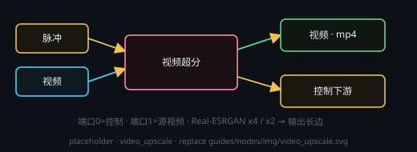

# 视频超分（Real-ESRGAN x4 / x2 · 独立后处理）

画布右键 → **处理节点 › 视频生成 › 视频超分**。给**已有视频**单独做超分：Real-ESRGAN 逐帧放大，再缩到输出长边；**每次运行只生成一个视频文件**（`.mp4`），写入节点的输出路径。它不跟 Minimax H3 生成一起跑，是**独立后处理**节点。

## 端子
- **输入**：端口 0 = 控制输入（固定）· 端口 1 = 源视频 · 端口 2+ = 可选素材（渐进展开）
- **输出**：端口 0 = 视频（下游可试看）· 端口 1 = 控制输出

## 设置
- 在节点头部 **⚙ 设置** 打开的设置窗口里改。
- **超分倍率**：x4（默认）/ x2（更快）；倍率是输出上限：输出 = min(目标长边, 源长边 × 倍率)
- **超分模型**：`RealESRGAN_x4plus.pth`（默认）/ `RealESRGAN_x2plus.pth`；x2 倍率时本机有 x2 权重会优先用它
- **目标长边（像素）**：1280–7680（默认 3840 = 4K），是输出长边的上限
- **分块 tile（像素）**：0–1024（默认 512），0 = 后端默认 512；显存只跟它有关，512 适合 16G 机器
- **逐帧批量 per_batch**：默认 1 · **低显存安全档（强制逐帧）**：默认开（分块 fp16 省显存）
- **抽卡次数**：1–10，多次时输出命名为 `#1`、`#2` … · **输出路径**：接了保存节点可留空

## 注意
- 默认走逐帧分块流式链（`h3-pack/post/stream_upscale.py`）：每帧处理完立刻编码写盘，常驻内存**与视频时长、分辨率、倍率都无关**，所以 **16G 内存也能完成 15 秒级视频的 x2 / x4 超分**。
- 音轨原样直拷；首次 OOM 会自动降一档重试一次（分块减半 + fp32）。
- 脚本 / venv 缺失或流式链非 OOM 失败时才**已回退图路径**（控制台写明原因），那时整段帧攒在内存里，更吃 RAM。
- 全局同一时刻只允许 1 个音视频任务（音乐 / 语音 / 视频 / 超分 / 补帧互斥）；超分与补帧互相独立，可串成 **H3 → 视频超分 → 视频补帧**。
