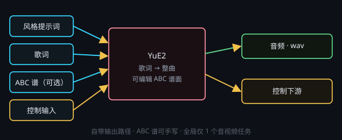

# YuE2 音乐生成（歌词 → 整曲）

画布右键 → **处理节点 › 音频生成 › YuE2**。本地 YuE2 后端：给它一段风格提示词 + 一份歌词，直接唱出整首歌（还可顺带产出 ABC 谱）；**每次运行只生成一个音频文件**（`.wav`）。

## 端子
- **输入**：端口 0 = 风格提示词（必填）· 端口 1 = 歌词（可选，不接 / 留空按纯器乐 `[instrumental]`）· 端口 2 = ABC 谱（可选）· 端口 3 = 控制输入
- **输出**：端口 0 = 音频（下游可试听 / 保存）· 端口 1 = 控制输出

## 设置
- 在节点头部 **⚙ 设置** 打开的设置窗口里改。
- **输出路径**：`.wav` 保存位置（相对工作目录 / 节点层子文件夹）；数据输出接了「保存」节点就可以留空，由那个保存节点落盘；没接时必填，留空点 ▶ 会提示「未设置输出路径时无法启动生成」。
- **思维链档位**：`full`（完整思维链，质量最好，默认）· `melody`（旋律引导，更快）· `off`（关思维链，只按提示词）
- **抽卡次数**：连续生成次数（1–10），多次时输出命名为 `#1`、`#2` … · **种子** + **摇数（每次执行种子 +1，默认开）**
- **auto CPU offload（24G 推荐）**：默认开

## 用法
- 风格提示词接端口 0（歌词接端口 1，不接就出器乐）→ 设输出路径 → 点 ▶。

## 注意
- 全局同一时刻只允许 1 个音视频任务（音乐 / 语音 / 视频互斥）；后端实例全局只有一个，本节点与 Minimax Music 3 共用同一条串行链。
- 建议 NVIDIA 24G 显存级别；没装时节点显示「插件未安装」，安装入口在 **插件 › YuE2 本地音乐** 卡片，后端日志在封面右上角 ⓘ 的内嵌只读 console 里。
- 歌词 / 风格提示词可照**内置技能** `minimax-music-lyrics` / `minimax-music-prompt` 的口径（随应用发版，不用从创意工坊下载）；风格提示词固定产出**一段六句英文散文**。
- **插件报错弹窗**：按技能 `yue2-local-install` 在本插件 INSTALL_DIR 里自动修复并重启后端；主动取消、安装中、磁盘不够、没 N 卡这类只报告不自动修。
